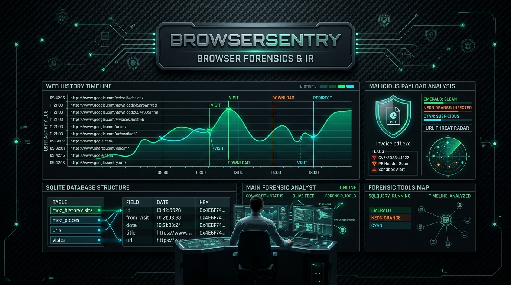

<div align="center">



# 🌐 BrowserSentry
### Framework Forense de Navegadores Web, Descargas y Extensiones para Windows
**Desarrollado por [Cru9](https://github.com/Cru9) | Ecosistema WinAudit-DFIR**

[](https://github.com/Cru9/WinAudit-DFIR)
[](https://www.python.org/)
[](#)
[](#)
[](#)
[](#)
[](./LICENSE)

</div>

**BrowserSentry** es un framework de **Respuesta a Incidentes y Triage Forense (DFIR)** en arquitectura dual (**Python 3 y PowerShell nativo**) diseñado para descubrir, auditar y correlacionar la actividad de navegación web en sistemas Windows. Extrae de forma segura historiales de descargas, cadenas de URLs de redirección, búsquedas de explotación y extensiones instaladas en **Google Chrome, Microsoft Edge, Brave Browser y Mozilla Firefox**, superando el bloqueo de archivos SQLite en vivo mediante copias forenses en memoria temporal.

---

## 💡 ¿Para qué sirve esta herramienta? (Explicación para no expertos)

> **En palabras simples:**  
> Más del 85% de los ciberataques inician en el navegador web: un usuario hace clic en un enlace de phishing, descarga sin querer un archivo malicioso (como un `.iso` o un `.exe`), o instala una extensión espía que roba sus contraseñas.  
> **BrowserSentry** inspecciona el historial de tus navegadores (incluso si están abiertos), te muestra **exactamente qué archivos se descargaron y desde qué página web**, detecta archivos peligrosos y revisa si hay extensiones sospechosas instaladas.

---

### 🚦 El Semáforo Forense de Navegación y Descargas

* 🟢 **Nivel 1: Confiable (Normal / Clean):**
  * **¿Qué significa?** Descargas de documentos estándar (`.pdf`, `.png`, `.jpg`, `.txt`) desde dominios corporativos o proveedores de confianza (GitHub, Microsoft, Google, etc.).
  * **Comportamiento:** Páginas web legítimas sin términos de evasión o túneles de comando y control.

* 🟡 **Nivel 2: Sospechoso (Alerta Heurística / Warning):**
  * **¿Qué significa?** Descargas con formatos comprimidos o contenedores de código que requieren análisis adicional.
  * **¿Por qué alerta?**
    1. **Formatos Comprimidos o Macros:** Descargas con extensión `.zip`, `.rar`, `.7z` o documentos ofimáticos con macros (`.docm`, `.xlsm`).
    2. **Búsquedas de Exploitation:** Búsquedas registradas en motores web sobre herramientas de hacking, evasión o credential dumping (`mimikatz`, `c2 framework`, `reverse shell`, `sqlmap`).

* 🔴 **Nivel 3: Crítico (Amenaza Inminente / Malicious Payload):**
  * **¿Qué significa?** ¡Alerta máxima! Evidencia de entrega o descarga de artefactos de intrusión directa.
  * **¿Por qué alerta en rojo?**
    1. **Contenedores de Disco y Ejecutables:** Descarga de archivos ejecutables (`.exe`, `.scr`, `.bat`, `.ps1`) o imágenes de disco (`.iso`, `.vhd`, `.img`) frecuentemente usadas para eludir filtros Mark-of-the-Web (MOTW).
    2. **Túneles Dinámicos y Almacenamiento C2:** Descargas o visitas a servicios de túnel inverso (`duckdns.org`, `ngrok-free.app`, `serveo.net`, `trycloudflare.com`, o adjuntos sospechosos en Discord/Telegram CDN).

---

## 🎯 Cobertura Táctica MITRE ATT&CK®

| Táctica MITRE | Técnica / Subtécnica | ID MITRE | Detección en BrowserSentry |
| :--- | :--- | :--- | :--- |
| **Initial Access** | Phishing: Spearphishing Link | [`T1566.002`](https://attack.mitre.org/techniques/T1566/002/) | Rastreo de enlaces web visitados y cadenas de descarga de phishing |
| **Execution** | User Execution: Malicious Link | [`T1204.001`](https://attack.mitre.org/techniques/T1204/001/) | Correlación de clics del usuario hacia payloads externos |
| **Persistence** | Browser Extensions | [`T1176`](https://attack.mitre.org/techniques/T1176/) | Auditoría de complementos y extensiones no oficiales o en modo desarrollador |
| **Defense Evasion** | Mark-of-the-Web Bypass | [`T1553.005`](https://attack.mitre.org/techniques/T1553/005/) | Detección de descargas de archivos ISO/VHD diseñados para eludir SmartScreen |

---

## 🚀 Inicio Rápido

### Opción 1: Lanzador con Elevación Automática UAC (Recomendado)
Haz doble clic en **`Ejecutar-BrowserSentry.bat`**. Detectará tus navegadores automáticamente e iniciará el menú interactivo o motor nativo.

### Opción 2: Ejecución desde Terminal (Python 3)
```powershell
# Modo interactivo con menú gráfico
python BrowserSentry.py

# Modo silencioso (Headless) con exportación automática a HTML, JSON y CSV
python BrowserSentry.py --all
```

### Opción 3: Ejecución Nativa en PowerShell
```powershell
# Auditoría forense directa
powershell -ExecutionPolicy Bypass -File .\BrowserSentry.ps1 -SoloTriage
```

---

## 📊 Artefactos de Salida
Cada auditoría genera reportes estructurados con marca temporal en la carpeta `Reportes/`:
* `BrowserSentry_Report_YYYYMMDD_HHMMSS.json`: Estructura JSON completa de descargas, historial y extensiones.
* `BrowserSentry_Downloads_YYYYMMDD_HHMMSS.csv`: Tabla CSV de descargas para análisis pericial rápido.
* `BrowserSentry_Dashboard_YYYYMMDD_HHMMSS.html`: Dashboard ejecutivo Cyberpunk con pestañas interactivas y clasificación de riesgo.

---

## 📜 Licencia & Gobernanza
* **Autor:** [Cru9](https://github.com/Cru9)
* **Licencia:** MIT License
* **Filosofía:** 100% Nativo, 0 dependencias externas (`0-pip`).
