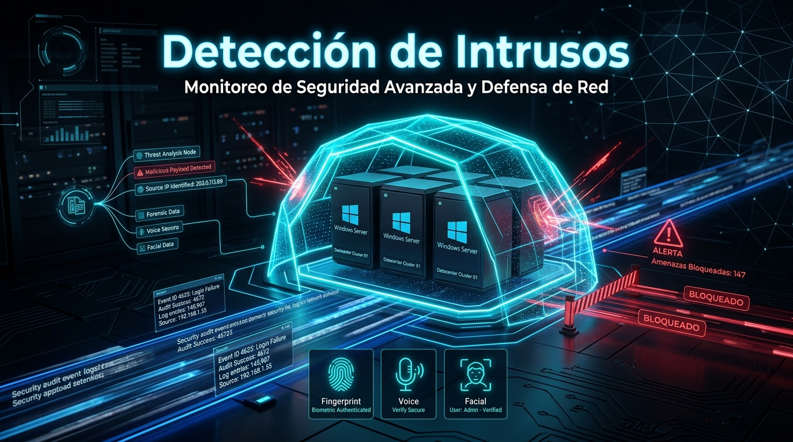
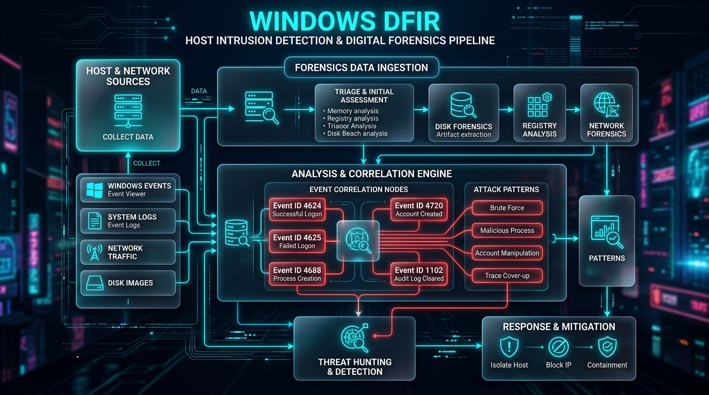

# IntruderDetector (Detección de Intrusos) 🛡️⚡
### Suite de Triage Forense de Host, Detección de Intrusos y Anti-Forensics Defense para Windows
**Desarrollado por [Cru9](https://github.com/Cru9)**



[](https://github.com/Cru9/WinAudit-DFIR)
[](https://www.python.org/)
[](https://github.com/)
[](https://github.com/)
[](LICENSE)
[](https://attack.mitre.org/)

---

## 🧭 Visión General

**IntruderDetector** es una solución forense integral y ligera diseñada para responder con precisión y velocidad a la pregunta crítica del analista de seguridad: ***¿Alguien ha intentado o logrado vulnerar este equipo Windows?***

El módulo forma parte del ecosistema **WinAudit-DFIR** y está capacitado para operar tanto de forma **individual e independiente** en investigaciones de host, como de forma **grupal y coordinada** dentro de la suite maestra mediante exportaciones estructuradas en JSON, CSV y Dashboards HTML interactivos.

---

## 🚀 Capacidades y Módulos Forenses

| Módulo | Event ID | Técnica / Táctica | Qué Detecta & Correlaciona |
| :--- | :--- | :--- | :--- |
| **Integridad de Logs** | `1102` / `104` | Anti-Forensics (`T1070.001`) | Vaciado intencional de registros de Seguridad o Sistema para encubrir huellas. |
| **Hunter de Fuerza Bruta** | `4625` / `4740` | Password Spraying (`T1110.001`) | Intentos fallidos, clasificación IP (privada vs pública), tasa de ataque y cuentas bloqueadas. |
| **Movimiento Lateral & RDP** | `4624` (Tipo 10 / 3) | Remote Services (`T1021.001`) | Sesiones remotas interactivas por Escritorio Remoto o carpetas compartidas SMB. |
| **Persistencia de Cuentas** | `4720` / `4732` / `4728` | Create Local Account (`T1136.001`) | Creación de usuarios no autorizados o adición de miembros a grupos privilegiados. |
| **Auditoría de Administradores** | `S-1-5-32-544` | Privilege Discovery (`T1087.002`) | Inspección de miembros del grupo Administradores mediante SID universal agnóstico al idioma. |
| **Hunter de Comandos LOLBAS** | `4688` / `4104` | Process Injection & LOLBAS (`T1490`) | Destrucción de copias de seguridad (`vssadmin delete shadows`), `certutil`, `powershell -enc`. |
| **Persistencia por Servicios** | `7045` (System) | Create Windows Service (`T1543.003`) | Nuevos servicios instalados en el sistema (tácticas APT / ransomware / PsExec). |
| **Persistencia en Inicio & Tareas** | N/A | Boot Autostart & Tasks (`T1547.001` / `T1053`) | Inspección de `Win32_StartupCommand`, tareas raíz no-Microsoft y verificación criptográfica **Authenticode**. |
| **Radar en Tiempo Real (SIEM)** | Múltiple | Real-time Tail Monitoring | Escucha continua de eventos críticos con alertas auditivas y visuales inmediatas. |

---

## 🎯 Matriz Visual de Amenazas y Triage Forense



---

## 💻 Modos de Ejecución

### 1. Lanzador Inteligente (.bat) — *Recomendado*
El script detecta automáticamente si cuentas con **Python 3** instalado en tu sistema; de ser así, ejecuta el core analítico de Python. En caso contrario, realiza una conmutación por error transparente hacia el motor nativo de **PowerShell**.

```cmd
Ejecutar-Deteccion.bat
```
*(Solicita automáticamente elevación de Administrador sin bucles de ventanas).*

---

### 2. Ejecución Directa en Python (`.py`)
Compatible con Python 3.8+ sin librerías externas de terceros (`pip`).

#### Menú Interactivo Completo:
```cmd
python IntruderDetector.py
```

#### Modo Automatizado / Headless (Ideal para Triage Centralizado):
```cmd
# Auditoría de los últimos 7 días con exportación de reporte HTML, JSON y CSV
python IntruderDetector.py --scan --days 7 --json --csv --html

# Iniciar Radar de Intrusiones en Vivo (Monitor en tiempo real)
python IntruderDetector.py --live
```

---

### 3. Motor Nativo en PowerShell (`.ps1`)
Para entornos donde no es posible instalar Python o en auditorías directas vía consola PowerShell:

```powershell
.\IntruderDetector.ps1 -DiasAtras 7
```

---

## 📊 Dashboard Ejecutivo Cyberpunk y Exportación Forense

Cada auditoría genera evidencias estructuradas en la carpeta [`Reportes/`](Reportes/):
1. **Dashboard HTML Interactivo:** Diseño Cyberpunk Glassmorphism con tarjetas KPI, gráficos de severidad, tabla con filtro en tiempo real y vista ejecutiva para directivos o clientes. Puedes consultar una demostración en vivo en [`Reportes/IntruderDetector_Dashboard_Demo.html`](Reportes/IntruderDetector_Dashboard_Demo.html).
2. **Bundle JSON Forense:** Esquema estandarizado con metadatos del host, timestamp ISO 8601, lista de IoCs (IPs atacantes, usuarios comprometidos) listo para ser ingerido por herramientas SIEM o por la Master Suite de Cru9.
3. **Volcado CSV:** Formato tabular para análisis rápido en Excel o Jupyter Notebooks.

---

## 📂 Estructura del Módulo

```text
Detección de Intrusos/
│
├── IntruderDetector.py             # Motor central en Python 3 (CLI + GUI Dashboard + SIEM)
├── IntruderDetector.ps1            # Motor nativo avanzado en PowerShell 5.1+/7+
├── Auditar-Persistencia-Arranque.ps1 # Hunter de persistencia en inicio y tareas con firmas Authenticode
├── Auditoria-Seguridad.ps1         # Script original preservado para máxima compatibilidad
├── Ejecutar-Deteccion.bat          # Lanzador inteligente multi-runtime con UAC
├── Ejecutar-Auditoria.bat          # Script de compatibilidad retrocompatible
├── Cerrar-Ventanas-Deteccion.bat   # Limpieza y cierre seguro de procesos en consola
├── .gitignore                      # Reglas de exclusión de reportes dinámicos
├── LICENSE                         # Licencia MIT
├── SECURITY.md                     # Política de seguridad y uso responsable
├── CONTRIBUTING.md                 # Guía para desarrolladores
│
├── 📁 assets/                      # Banners e infografías de alta resolución
│   ├── banner.jpg
│   └── attack_threat_matrix.jpg
│
└── 📁 Reportes/                    # Almacenamiento de reportes y dashboard demo
    └── IntruderDetector_Dashboard_Demo.html
```

---

## 🤝 Operación Individual y Grupal (WinAudit-DFIR Suite)

- **Modo Individual:** Funciona de manera 100% aislada en cualquier equipo Windows cliente o servidor sin requerir conexión a internet ni herramientas adicionales.
- **Modo Grupal (Suite Maestra):** Se coordina con [`WiFiSentry`](../WiFiSentry/) y [`Suite-DFIR.bat`](../Suite-DFIR.bat) en la raíz del repositorio, compartiendo un estándar unificado de nomenclatura, reportes ejecutivos y cadena de custodia.

---

## 🛡️ Licencia y Créditos

Este proyecto está bajo la licencia **MIT** - consulta el archivo [LICENSE](LICENSE) para más detalles.

**Autor:** [Cru9](https://github.com/Cru9)  
**Propósito:** Investigación en ciberseguridad, respuesta a incidentes (IR) y concientización defensiva.
