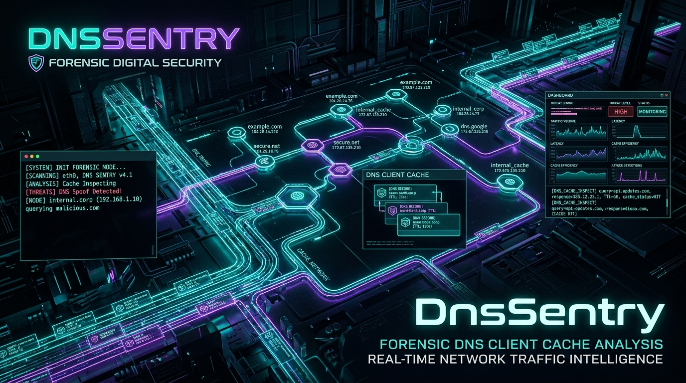

<div align="center">



# 🌐 DnsSentry
### Framework Forense de Caché DNS y Manipulación de Hosts para Windows
**Desarrollado por [Cru9](https://github.com/Cru9) | Ecosistema WinAudit-DFIR**

[](https://github.com/Cru9/WinAudit-DFIR)
[](https://www.python.org/)
[](#)
[](#)
[](#)
[](#)
[](./LICENSE)

</div>

**DnsSentry** es un framework de **Respuesta a Incidentes y Triage Forense (DFIR)** en arquitectura dual (**Python 3 y PowerShell nativo**) especializado en la inspección profunda de la memoria caché de resolución DNS activa en Windows, detección de túneles Command & Control (C2), algoritmos de generación de dominios (DGA), Fast-Flux, exfiltración por subdominios y auditoría criptográfica del archivo `hosts` frente a técnicas de evasión o sinkholing de seguridad.

---

## 💡 ¿Para qué sirve esta herramienta? (Explicación para no expertos)

> **En palabras simples:**  
> Cada vez que tu computadora se comunica con un sitio web, servidor o atacante, Windows guarda en secreto una lista temporal de los nombres de internet consultados en la memoria RAM (caché DNS).  
> Además, Windows posee un archivo maestro llamado `hosts` que tiene la última palabra sobre a dónde dirigir las conexiones.  
> **DnsSentry** extrae esa lista oculta de la memoria, detecta nombres de dominio raros creados por virus para comunicarse con sus servidores de control (C2), revisa si alguien alteró el archivo `hosts` para engañar a tu antivirus o redirigirte a páginas falsas, y verifica qué servidores DNS están configurados en tus tarjetas de red.

---

### 🚦 El Semáforo Forense de Caché DNS y Hosts

* 🟢 **Nivel 1: Confiable (Normal / Clean):**
  * **¿Qué significa?** Dominios corporativos estándar, redes de distribución de contenido legítimas (CDNs de Microsoft, Google, Cloudflare, Akamai) con nombres legibles y baja entropía.
  * **Archivo Hosts:** Archivo íntegro con comentarios estándar de Microsoft sin redirecciones anómalas.

* 🟡 **Nivel 2: Sospechoso (Alerta Heurística / Warning):**
  * **¿Qué significa?** Consultas con patrones inusuales o TLDs de alto riesgo que demandan correlación forense.
  * **¿Por qué alerta?**
    1. **TLDs de Alto Riesgo:** Dominios con terminaciones frecuentemente abusadas por campañas maliciosas (`.top`, `.xyz`, `.buzz`, `.club`, `.work`).
    2. **Etiquetas Largas / Exfiltración:** Dominios con etiquetas superiores a 40 caracteres o subdominios apilados típicos de exfiltración lenta o DNS rebinding.

* 🔴 **Nivel 3: Crítico (Amenaza Inminente / Malicious Tunnel):**
  * **¿Qué significa?** ¡Alerta roja de comunicación con infraestructuras de ataque o alteración del sistema!
  * **¿Por qué alerta en rojo?**
    1. **Túneles Dinámicos y C2 Reversos:** Presencia de servicios de tunneling en memoria (`duckdns.org`, `ngrok-free.app`, `serveo.net`, `trycloudflare.com`, `no-ip.org`, `localtunnel.me`).
    2. **Algoritmos DGA (Entropía Elevada):** Dominios aleatorios con alta entropía de Shannon calculada ($H \ge 3.75$), utilizados por botnets y ransomware para eludir bloqueos por reputación.
    3. **Hosts File Poisoning:** Modificación maliciosa del archivo `hosts` bloqueando URLs de telemetría de antivirus (Windows Defender, CrowdStrike, SentinelOne) o redirigiendo dominios bancarios/corporativos hacia IPs locales o atacantes (Sinkholing / Redirección).

---

## 🎯 Cobertura Táctica MITRE ATT&CK®

| Táctica MITRE | Técnica / Subtécnica | ID MITRE | Detección en DnsSentry |
| :--- | :--- | :--- | :--- |
| **Command and Control** | Application Layer Protocol: DNS | [`T1071.004`](https://attack.mitre.org/techniques/T1071/004/) | Balizas C2 sobre DNS, túneles dinámicos y exfiltración encubierta |
| **Defense Evasion** | Impair Defenses: Disable or Modify Tools | [`T1562.001`](https://attack.mitre.org/techniques/T1562/001/) | Sinkholing en `hosts` desactivando actualizaciones de seguridad o EDR |
| **Defense Evasion** | Data Manipulation: Stored Data Manipulation | [`T1565.001`](https://attack.mitre.org/techniques/T1565/001/) | Modificación no autorizada del mapeo de resolución local en `hosts` |
| **Command and Control** | Protocol Tunneling | [`T1572`](https://attack.mitre.org/techniques/T1572/) | DGA con alta entropía matemática de Shannon y consultas multi-etiqueta |

---

## 🚀 Inicio Rápido

### Opción 1: Lanzador con Elevación Automática UAC (Recomendado)
Haz doble clic en **`Ejecutar-DnsSentry.bat`**. Detectará automáticamente tu runtime (Python 3 o PowerShell) y solicitará elevación UAC para auditar adaptadores y archivo `hosts` en su totalidad.

### Opción 2: Ejecución desde Terminal (Python 3)
```powershell
# Modo interactivo en consola con telemetría visual ANSI
python DnsSentry.py

# Modo silencioso (Headless) con exportación forense estructurada
python DnsSentry.py --all
```

### Opción 3: Ejecución Nativa en PowerShell
```powershell
# Auditoría forense directa
powershell -ExecutionPolicy Bypass -File .\DnsSentry.ps1 -SoloTriage
```

---

## 📊 Artefactos de Salida
Cada auditoría genera evidencias estructuradas con marca temporal en la carpeta `Reportes/`:
* `DnsSentry_Report_YYYYMMDD_HHMMSS.json`: Estructura pericial completa con hashes SHA-256 e inventario para SIEM.
* `DnsSentry_Cache_YYYYMMDD_HHMMSS.csv`: Matriz tabular de resolución DNS para Timeline Explorer o análisis en hoja de cálculo.

---

## 📂 Estructura del Módulo

```text
DnsSentry/
├── DnsSentry.py                  # Core analítico en Python 3 (CLI ANSI, DGA Shannon & Triage)
├── DnsSentry.ps1                 # Motor nativo forense en PowerShell 5.1+ / 7+
├── Ejecutar-DnsSentry.bat        # Lanzador inteligente multi-runtime con UAC
├── Cerrar-Ventanas-DnsSentry.bat # Script de detención de procesos
├── assets/                       # Banners e infografías HUD de red y DNS
│   └── banner.jpg
├── Reportes/                     # Directorio de evidencias forenses
│   └── .gitkeep
├── LICENSE                       # Licencia MIT (Cru9)
├── SECURITY.md                   # Política de seguridad y divulgación
├── CONTRIBUTING.md               # Guía para desarrolladores y colaboradores
└── README.md                     # Documentación completa de DnsSentry
```

---

## 📜 Licencia & Gobernanza
* **Autor:** [Cru9](https://github.com/Cru9)
* **Licencia:** MIT License
* **Filosofía:** 100% Nativo, 0 dependencias externas (`0-pip`).
