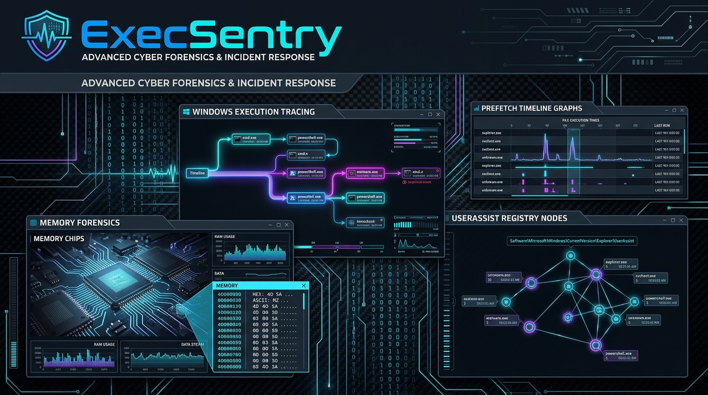

<div align="center">



# ⚡ ExecSentry
### Framework Forense de Evidencia de Ejecución en Windows (Prefetch, UserAssist ROT13 & BAM)
**Desarrollado por [Cru9](https://github.com/Cru9) | Ecosistema WinAudit-DFIR**

[](https://github.com/Cru9/WinAudit-DFIR)
[](https://www.python.org/)
[](#)
[](#)
[](#)
[](#)
[](./LICENSE)

</div>

**ExecSentry** es un framework de **Respuesta a Incidentes y Triage Forense (DFIR)** en arquitectura dual (**Python 3 y PowerShell nativo**) diseñado para reconstruir la cronología exacta de programas y comandos ejecutados en un equipo Windows. Rastrea y correlaciona artefactos clave del sistema operativo: **Windows Prefetch** (`.pf`), claves **UserAssist** ofuscadas en **ROT13**, y el subsistema de moderación de actividad **BAM/DAM** en el registro por SID de usuario.

---

## 💡 ¿Para qué sirve esta herramienta? (Explicación para no expertos)

> **En palabras simples:**  
> Cuando un atacante o software malicioso infecta una computadora, su primer paso tras ejecutar el virus suele ser borrar el archivo `.exe` para no dejar rastro.  
> Sin embargo, Windows guarda "huellas digitales imborrables" de cada programa que se abre.  
> **ExecSentry** localiza y analiza esas huellas para responder las preguntas críticas de una investigación:  
> ***¿Qué programa se abrió? ¿A qué hora exacta? ¿Cuántas veces se ejecutó? ¿Desde qué carpeta (ej. Descargas o Temp)? ¿Y qué usuario lo abrió?***

---

### 🚦 El Semáforo Forense de Evidencia de Ejecución

* 🟢 **Nivel 1: Confiable (Normal / Clean):**
  * **¿Qué significa?** Ejecutables estándar de Windows o de aplicaciones de confianza instaladas en `C:\Program Files` o `C:\Windows\System32` (navegadores, suites ofimáticas, herramientas administrativas de fábrica).
  * **Comportamiento:** Conteo de ejecuciones habitual y rutas legítimas.

* 🟡 **Nivel 2: Sospechoso (Alerta Heurística / Warning):**
  * **¿Qué significa?** Binarios legítimos utilizados de forma inusual o programas ejecutados desde rutas no convencionales.
  * **¿Por qué alerta?**
    1. **Ejecución desde rutas temporales:** Binarios lanzados desde `%TEMP%`, `AppData\Roaming`, `C:\Users\Public` o `Downloads` (vector típico de malware).
    2. **LOLBins (Living Off The Land Binaries):** Uso de utilidades nativas de Windows para propósitos maliciosos (`certutil.exe`, `bitsadmin.exe`, `mshta.exe`, `powershell.exe -enc`, `wmic.exe`, `vssadmin.exe`).

* 🔴 **Nivel 3: Crítico (Amenaza Inminente / Critical Execution):**
  * **¿Qué significa?** ¡Alerta roja de compromiso! Evidencia de ejecución de herramientas de hacking o evasión activa.
  * **¿Por qué alerta en rojo?**
    1. **Herramientas Ofensivas Conocidas:** Rastros de ejecución de frameworks de explotación, cred-dumpers o C2 (`mimikatz`, `rubeus`, `procdump`, `chisel`, `bloodhound`, `psexec`, `lazagne`).
    2. **Masquerading / Doble Extensión:** Ejecutables camuflados como documentos legítimos (ej. `factura.pdf.exe`, `reporte.docx.scr`).

---

## 🎯 Cobertura Táctica MITRE ATT&CK®

| Táctica MITRE | Técnica / Subtécnica | ID MITRE | Detección en ExecSentry |
| :--- | :--- | :--- | :--- |
| **Execution** | User Execution: Malicious File | [`T1204.002`](https://attack.mitre.org/techniques/T1204/002/) | Reconstrucción de ejecuciones interactivas de usuario en UserAssist (ROT13) |
| **Execution** | Command and Scripting Interpreter | [`T1059`](https://attack.mitre.org/techniques/T1059/) | Detección de instancias de `cmd.exe`, `powershell.exe`, `cscript.exe` en Prefetch y BAM |
| **Defense Evasion** | Indicator Removal: File Deletion | [`T1070.004`](https://attack.mitre.org/techniques/T1070/004/) | Evidencia forense de binarios ejecutados que ya fueron eliminados del disco |
| **Defense Evasion** | Masquerading: Double Extension | [`T1036.007`](https://attack.mitre.org/techniques/T1036/007/) | Identificación de archivos con dobles extensiones falsificadas |

---

## 🚀 Inicio Rápido

### Opción 1: Lanzador con Elevación Automática UAC (Recomendado)
Haz doble clic en **`Ejecutar-ExecSentry.bat`**. Detectará automáticamente tu runtime (Python 3 o PowerShell) y solicitará elevación UAC para auditar Prefetch y BAM en su totalidad.

### Opción 2: Ejecución desde Terminal (Python 3)
```powershell
# Modo interactivo con menú gráfico
python ExecSentry.py

# Modo silencioso (Headless) con exportación automática a HTML, JSON y CSV
python ExecSentry.py --all
```

### Opción 3: Ejecución Nativa en PowerShell
```powershell
# Auditoría forense directa
powershell -ExecutionPolicy Bypass -File .\ExecSentry.ps1 -SoloTriage
```

---

## 📊 Artefactos de Salida
Cada auditoría genera reportes estructurados con marca temporal en la carpeta `Reportes/`:
* `ExecSentry_Report_YYYYMMDD_HHMMSS.json`: Estructura JSON completa para ingesta SIEM.
* `ExecSentry_Report_YYYYMMDD_HHMMSS.csv`: Tabla para análisis en Excel o Timeline Explorer.
* `ExecSentry_Dashboard_YYYYMMDD_HHMMSS.html`: Dashboard ejecutivo Cyberpunk con métricas y buscador interactivo.

---

## 📜 Licencia & Gobernanza
* **Autor:** [Cru9](https://github.com/Cru9)
* **Licencia:** MIT License
* **Filosofía:** 100% Nativo, 0 dependencias externas (`0-pip`).
