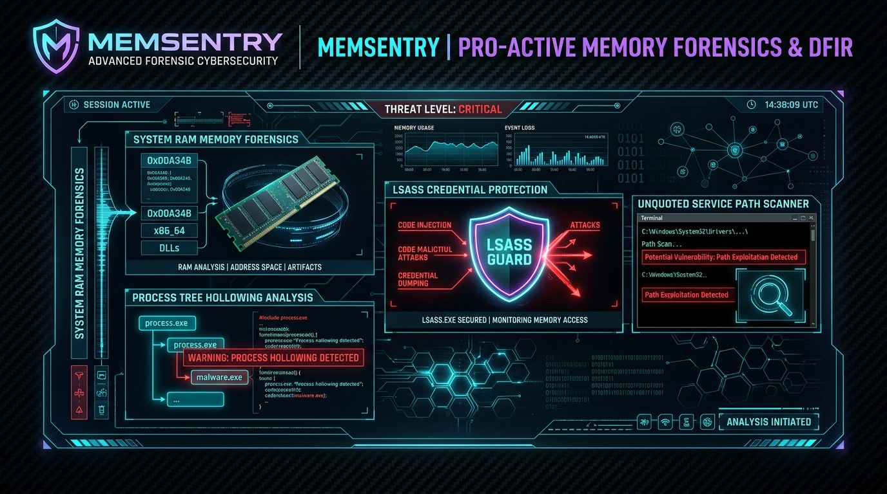

<div align="center">



# 🛡️ MemSentry
### Framework Forense de Procesos en RAM, Inyección & LSASS Guard para Windows
**Desarrollado por [Cru9](https://github.com/Cru9) | Ecosistema WinAudit-DFIR**

[](https://github.com/Cru9/WinAudit-DFIR)
[](https://www.python.org/)
[](#)
[](#)
[](#)
[](#)
[](./LICENSE)

</div>

**MemSentry** es un framework de **Respuesta a Incidentes y Triage Forense (DFIR)** en arquitectura dual (**Python 3 y PowerShell nativo**) diseñado para auditar en tiempo real los procesos activos en memoria RAM, detectar técnicas de suplantación de identidad de procesos (*Process Masquerading*), anomalías de linaje padre-hijo, auditar la protección criptográfica del proceso **LSASS** (frenando ataques de robo de credenciales como Mimikatz) y cazar rutas de servicio sin entrecomillar (*Unquoted Service Paths*).

---

## 💡 ¿Para qué sirve esta herramienta? (Explicación para no expertos)

> **En palabras simples:**  
> Cuando un virus o troyano se instala en tu equipo, a menudo se "disfraza" con nombres de procesos inocentes de Windows (como `svchost.exe` o `explorer.exe`) para que el administrador no sospeche al abrir el Administrador de Tareas.  
> Además, los atacantes intentan ingresar a la memoria del proceso del sistema **LSASS** para robar las contraseñas de todos los usuarios que han iniciado sesión.  
> **MemSentry** revisa cada proceso en ejecución, verifica si el programa que lo inició tiene sentido lógico, detecta comandos ocultos y comprueba si tu Windows tiene blindado el almacén de contraseñas contra herramientas de hackeo.

---

### 🚦 El Semáforo Forense de Memoria y Procesos

* 🟢 **Nivel 1: Confiable (Normal / Clean):**
  * **¿Qué significa?** Procesos del sistema firmados por Microsoft ejecutándose desde `C:\Windows\System32`, con linaje padre legítimo (`services.exe` -> `svchost.exe`, `wininit.exe` -> `lsass.exe`).
  * **Protección:** LSASS ejecutándose en modo `RunAsPPL` (Protected Process Light) y credenciales en texto claro deshabilitadas.

* 🟡 **Nivel 2: Sospechoso (Alerta Heurística / Warning):**
  * **¿Qué significa?** Procesos o configuraciones que presentan debilidades o requieren inspección pericial.
  * **¿Por qué alerta?**
    1. **Rutas de Servicio sin Comillas (`T1574.009`):** Servicios con ejecutables alojados en rutas con espacios que no están entrecomilladas (vector de elevación local de privilegios).
    2. **Comandos Codificados en Base64:** Sesiones de PowerShell ejecutadas con flags `-enc` o `-EncodedCommand`.

* 🔴 **Nivel 3: Crítico (Amenaza Inminente / Critical Compromise):**
  * **¿Qué significa?** ¡Alerta roja de evasión o robo de credenciales activo!
  * **¿Por qué alerta en rojo?**
    1. **Masquerading de Sistema:** Binarios con nombres críticos (`svchost.exe`, `csrss.exe`) ejecutándose fuera de `System32` (ej. en `%TEMP%`, `AppData` o `C:\Users\Public`).
    2. **Linaje Padre Prohibido:** Aplicaciones de ofimática (Word, Excel, PowerPoint, Acrobat Reader) o servidores web generando procesos de consola (`cmd.exe`, `powershell.exe`).
    3. **Ataques a LSASS:** Detección de comandos de volcado de memoria (`procdump lsass.exe`, `comsvcs.dll MiniDump`, `reg save HKLM\SAM`).

---

## 🎯 Cobertura Táctica MITRE ATT&CK®

| Táctica MITRE | Técnica / Subtécnica | ID MITRE | Detección en MemSentry |
| :--- | :--- | :--- | :--- |
| **Credential Access** | OS Credential Dumping: LSASS Memory | [`T1003.001`](https://attack.mitre.org/techniques/T1003/001/) | Auditoría de RunAsPPL, WDigest y comandos de volcado en memoria |
| **Defense Evasion** | Process Injection | [`T1055`](https://attack.mitre.org/techniques/T1055/) | Identificación de padres anómalos y procesos del sistema suplantados |
| **Defense Evasion** | Masquerading: Match Legitimate Name | [`T1036.005`](https://attack.mitre.org/techniques/T1036/005/) | Rastreo de binarios falsos fuera de los directorios System32 |
| **Privilege Escalation** | Hijack Execution Flow: Unquoted Service Path | [`T1574.009`](https://attack.mitre.org/techniques/T1574/009/) | Auditoría automatizada de claves de servicio en HKLM |

---

## 🚀 Inicio Rápido

### Opción 1: Lanzador con Elevación Automática UAC (Recomendado)
Haz doble clic en **`Ejecutar-MemSentry.bat`**. Detectará tus privilegios de Administrador automáticamente para auditar servicios y claves protegidas de LSA.

### Opción 2: Ejecución desde Terminal (Python 3)
```powershell
# Modo interactivo con menú gráfico
python MemSentry.py

# Modo silencioso (Headless) con exportación automática a HTML, JSON y CSV
python MemSentry.py --all
```

### Opción 3: Ejecución Nativa en PowerShell
```powershell
# Auditoría forense directa
powershell -ExecutionPolicy Bypass -File .\MemSentry.ps1 -SoloTriage
```

---

## 📊 Artefactos de Salida
Cada auditoría genera reportes estructurados con marca temporal en la carpeta `Reportes/`:
* `MemSentry_Report_YYYYMMDD_HHMMSS.json`: Estructura JSON completa de procesos, LSASS y servicios.
* `MemSentry_Processes_YYYYMMDD_HHMMSS.csv`: Tabla CSV de procesos para análisis rápido en hojas de cálculo.
* `MemSentry_Dashboard_YYYYMMDD_HHMMSS.html`: Dashboard ejecutivo Cyberpunk con pestañas interactivas, métricas y filtrado en vivo.

---

## 📜 Licencia & Gobernanza
* **Autor:** [Cru9](https://github.com/Cru9)
* **Licencia:** MIT License
* **Filosofía:** 100% Nativo, 0 dependencias externas (`0-pip`).
