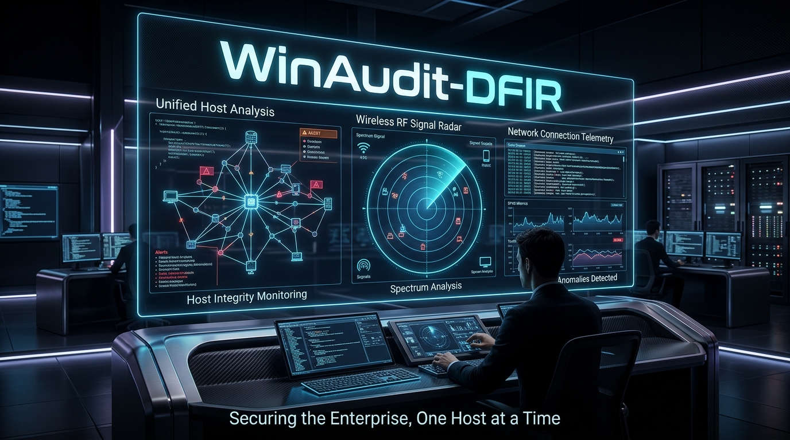
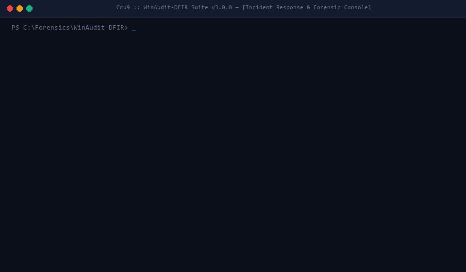

# WinAudit-DFIR 🛡️📡
### Ecosistema Modular de Triage Forense y Detección de Amenazas en Windows
**Desarrollado por [Cru9](https://github.com/Cru9)**

[](https://github.com/Cru9/WinAudit-DFIR/releases)
[](https://github.com/Cru9/WinAudit-DFIR/actions/workflows/ci.yml)
[](https://github.com/Cru9/WinAudit-DFIR)
[](https://www.python.org/)
[](https://github.com/Cru9/WinAudit-DFIR)
[](LICENSE)
[](https://attack.mitre.org/)
[](https://github.com/Cru9/WinAudit-DFIR/stargazers)
[](https://github.com/Cru9/WinAudit-DFIR/network/members)



<div align="center">
  
  <p><em>Demostración en vivo: Ejecución interactiva del motor forense dual en tiempo real.</em></p>
</div>

---

## 🧭 Visión General del Proyecto

**WinAudit-DFIR** es un repositorio maestro y suite modular diseñada para analistas de **Blue Team**, especialistas en **DFIR** (Digital Forensics and Incident Response), auditores de seguridad y administradores de sistemas. 

El objetivo de este ecosistema es centralizar herramientas ligeras, de alta fidelidad y sin dependencias invasivas para diagnosticar, auditar y defender entornos Windows contra intrusiones tanto a nivel de sistema operativo como en el espectro de radiofrecuencia (Wi-Fi).

```
                                    ┌─────────────────────────────────────────┐
                                    │        WinAudit-DFIR Master Suite       │
                                    │              (Cru9 / DFIR)              │
                                    └────────────────────┬────────────────────┘
                                                         │
         ┌───────────────────┬───────────────────┼───────────────────┬───────────────────┐
         ▼                   ▼                   ▼                   ▼                   ▼
┌───────────────────┐┌───────────────────┐┌───────────────────┐┌───────────────────┐┌───────────────────┐
│Detección Intrusos ││    WiFiSentry     ││   SocketSentry    ││   StartupSentry   ││     UsbSentry     │
│  Forense de Host  ││Forense Inalámbrico││ Threat Hunter Red ││Persistencia/Firmas││Almacenamiento/Bad │
├───────────────────┤├───────────────────┤├───────────────────┤├───────────────────┤├───────────────────┤
│• Security Events  ││• Auditoría 802.11 ││• Sockets TCP/UDP  ││• Win32_StartupCmd ││• Historial USBSTOR│
│• Fuerza Bruta 4625││• Rogue AP / Evil  ││• Balizas C2 Hunter││• Claves Registry  ││• MountedDevices E:│
│• Evasión Log 1102 ││• PBKDF2 Benchmark ││• Abuse Feodo IOCs ││• Tareas Raíz no-MS││• BadUSB / Ducky  │
│• Logons RDP / SMB ││• Sensor Proximidad││• Catálogo LOLBins ││• Authenticode Sign││• Seriales Hardware│
│• Radar SIEM Vivo  ││• Heatmap Señal RF ││• Volcado MiniDump ││• Masquerading Hunt││• Live vs Histórico│
└───────────────────┘└───────────────────┘└───────────────────┘└───────────────────┘└───────────────────┘
```

---

## 🗂️ Módulos Integrados

### 1. 🛡️ [Detección de Intrusos](Detección%20de%20Intrusos/) — Triage Forense de Host, Event Logs & SIEM Radar
Especializado en la inspección automatizada y análisis forense del Visor de Eventos de Seguridad (`Security Log`) y Sistema (`System Log`) de Windows. Disponible en Python 3 (`IntruderDetector.py`) y PowerShell (`IntruderDetector.ps1`).
* **Inspección de Registros de Seguridad:** Detección de borrado intencional de logs (Anti-Forensics / Event ID 1102 y 104).
* **Vectores de Autenticación & Fuerza Bruta:** Rastreo de ataques de fuerza bruta y password spraying (Event ID 4625), clasificación de IPs atacantes y cuentas bloqueadas (4740).
* **Movimiento Lateral:** Detección de accesos RDP remotos interactivos (Event ID 4624 tipo 10) y sesiones SMB de red (tipo 3).
* **Persistencia y Elevación:** Identificación de creación anómala de usuarios o modificación de grupos de administradores (Event IDs 4720, 4732, 4728) mediante resolución robusta de SIDs (`S-1-5-32-544`).
* **Nuevos Servicios del Sistema:** Detección de nuevos servicios instalados en el sistema operativo (Event ID 7045 en System Log / tácticas APT, PsExec y ransomware).
* **Hunter de Comandos LOLBAS & Ransomware:** Detección de eliminación de copias de seguridad (`vssadmin delete shadows`), `certutil`, `powershell -enc` (Event ID 4688).
* **Radar SIEM en Tiempo Real:** Monitor continuo en vivo (*Live Tail*) para alertar de intrusiones activas al instante con avisos visuales y sonoros.
* 🔗 *[Ver documentación detallada de Detección de Intrusos →](Detección%20de%20Intrusos/README.md)*

---

### 2. 📡 [WiFiSentry](WiFiSentry/) — Auditoría Forense Wi-Fi, Evil Twin Hunter & Mapa de Calor
Herramienta de nivel industrial para auditoría defensiva y análisis forense del espectro inalámbrico 802.11 en Windows. Disponible en Python 3 (`WiFiSentry.py`) y PowerShell (`WiFiSentry.ps1`).
* **Rogue AP Hunter (Evil Twin Radar):** Detección en tiempo real de suplantación de identidad Wi-Fi comparando BSSID (MAC), OUI de fabricantes, discrepancias de cifrado y anomalías de canal.
* **Calculadora de Entropía & Benchmark de Crackeo:** Estimación matemática de resistencia WPA2/WPA3 frente a ataques de diccionario y ataques masivos por GPU (clústeres Hashcat / RTX 4090).
* **Sensor de Proximidad & Heatmap Espectral:** Radar térmico en consola en vivo para rastrear fuentes emisoras mediante delta de señal ($\Delta \pm\%$), nivel RSSI estimado y saturación de canales.
* **Exportación Forense:** Generación de reportes ejecutivos en HTML interactivo (Glassmorphism cyberpunk) y volcados JSON/CSV estructurados.
* 🔗 *[Ver documentación detallada de WiFiSentry →](WiFiSentry/README.md)*

---

### 3. 🌐 [SocketSentry](SocketSentry/) — Framework Forense de Red, LOLBins y C2 Threat Hunting
Framework especializado en la inspección profunda de sockets de red y detección de actividad Command & Control (C2) en tiempo real. Disponible en Python 3 (`SocketSentry.py`) y PowerShell (`SocketSentry.ps1`).
* **Correlación de Sockets en Memoria:** Mapeo de conexiones TCP/UDP activas hacia procesos propietarios, rutas en disco y líneas de comando completas.
* **Threat Intelligence Integrada:** Sincronización con Abuse.ch Feodo Tracker (IPs C2 activas) y catálogo de más de 245 binarios LOLBAS.
* **Detección de Balizas C2 (*Beaconing*):** Algoritmo de análisis de cadencia temporal para identificar llamadas periódicas hacia infraestructuras de ataque.
* **Respuesta y Preservación Forense:** Generación de volcados de memoria volátil (`MiniDump`) y contención activa mediante bloqueo saliente en Windows Defender Firewall.
* 🔗 *[Ver documentación detallada de SocketSentry →](SocketSentry/README.md)*

---

### 4. 🚀 [StartupSentry](StartupSentry/) — Hunter de Persistencia en Inicio, Tareas Programadas y Firmas Authenticode
Framework forense especializado en el triage de mecanismos de persistencia en el arranque de Windows. Disponible en Python 3 (`StartupSentry.py`) y PowerShell nativo (`StartupSentry.ps1`).
* **Auditoría de Auto-Arranque:** Inspección exhaustiva de `Win32_StartupCommand`, carpetas de inicio de usuario/sistema y claves de registro en `HKLM`/`HKCU:Run` y `RunOnce`.
* **Tareas Programadas en Raíz (`\`):** Detección de tareas programadas no pertenecientes a Microsoft y análisis de gatillos con intervalos recurrentes de alta frecuencia (`<= 30 min`).
* **Validación Criptográfica Authenticode:** Verificación automatizada de firmas digitales (`Valid`, `NotSigned`, `HashMismatch`), emisores y certificados.
* **Heurística Anti-Evasión:** Identificación de binarios alojados en `AppData`, `Temp`, `Users\Public`, suplantación de procesos del sistema (*Masquerading*) y LOLBins.
* **Dashboards y Evidencias:** Generación de dashboards ejecutivos interactivos HTML Cyberpunk y exportación estructurada JSON/CSV.
* 🔗 *[Ver documentación detallada de StartupSentry →](StartupSentry/README.md)*

---

### 5. 💾 [UsbSentry](UsbSentry/) — Forense de Dispositivos USB, Exfiltración Física y BadUSB Hunter
Framework forense especializado en la reconstrucción histórica de almacenamiento extraíble y detección de hardware malicioso. Disponible en Python 3 (`UsbSentry.py`) y PowerShell nativo (`UsbSentry.ps1`).
* **Historial USBSTOR & Seriales de Hardware:** Extracción de fabricante, modelo, revisión y número de serie único de cada dispositivo conectado históricamente.
* **Correlación de Letras de Unidad (MountedDevices):** Mapeo forense de particiones y letras (`E:`, `F:`) asignadas en el sistema.
* **Caza de Dispositivos BadUSB:** Detección de inyectores de teclado maliciosos emulados (Hak5 Rubber Ducky, Bash Bunny, Flipper Zero, emuladores Arduino/Pico HID).
* **Marcas Temporales Forenses:** Recuperación del último evento de conexión/desconexión mediante `LastWriteTime` de registro y SetupAPI.
* **Dashboard y Evidencias:** Generación de dashboards ejecutivos interactivos HTML Cyberpunk y exportación estructurada JSON/CSV.
* 🔗 *[Ver documentación detallada de UsbSentry →](UsbSentry/README.md)*

---

## 🎯 Cobertura con la Matriz MITRE ATT&CK®

| Módulo | Táctica MITRE | ID Técnica | Descripción / Detección |
| :--- | :--- | :--- | :--- |
| **Detección de Intrusos** | Defense Evasion | `T1070.001` | Clear Windows Event Logs (Vaciado de registro de auditoría 1102 / 104) |
| **Detección de Intrusos** | Credential Access | `T1110.001` | Password Guessing / Brute Force (Intentos de acceso fallidos 4625) |
| **Detección de Intrusos** | Lateral Movement | `T1021.001` | Remote Desktop Protocol (Sesiones interactivas RDP Tipo 10) |
| **Detección de Intrusos** | Persistence | `T1136.001` | Create Local Account (Creación de cuentas no autorizadas 4720) |
| **Detección de Intrusos** | Impact / Evasion | `T1490` | Inhibit System Recovery (Comandos vssadmin / wmic delete shadows 4688) |
| **Detección de Intrusos** | Persistence | `T1543.003` | Windows Service Creation (Nuevos servicios sospechosos 7045) |
| **WiFiSentry** | Discovery | `T1040` | Network Sniffing / Wi-Fi Reconnaissance |
| **WiFiSentry** | Credential Access | `T1110` | Brute Force (Estimación de crackeo de PSK WPA2/WPA3) |
| **WiFiSentry** | Initial Access | `T1557` | Adversary-in-the-Middle / Rogue AP (Ataques Evil Twin) |
| **SocketSentry** | Command and Control | `T1071.001` | Application Layer Protocol (Canales C2 sobre HTTP/HTTPS/Puertos raros) |
| **SocketSentry** | Defense Evasion | `T1218` | System Binary Proxy Execution (Abuso de LOLBins en red) |
| **SocketSentry** | Command and Control | `T1571` | Non-Standard Port (Puertos de malware 4444, 50050, 1337) |
| **SocketSentry** | Ingress Tool Transfer | `T1105` | Ingress Tool Transfer (Cradles de descarga con Certutil / PowerShell) |
| **StartupSentry** | Persistence | `T1547.001` | Registry Run Keys / Startup Folder (Win32_StartupCommand y Run keys) |
| **StartupSentry** | Persistence / Execution | `T1053.005` | Scheduled Tasks (Tareas raíz no-MS e intervalos recurrentes <= 30 min) |
| **StartupSentry** | Defense Evasion | `T1553.002` | Subvert Trust Controls: Code Signing (Binarios NotSigned / HashMismatch) |
| **StartupSentry** | Defense Evasion | `T1036.005` | Masquerading: Match Legitimate Name (Binarios de sistema fuera de System32) |
| **UsbSentry** | Exfiltration | `T1052.001` | Exfiltration Over Physical Medium (Fuga de datos y exfiltración por USB) |
| **UsbSentry** | Initial Access / Execution | `T1200` | Hardware Additions (BadUSB / Rubber Ducky / Inyección de pulsaciones) |
| **UsbSentry** | Lateral Movement | `T1091` | Replication Through Removable Media (Propagación por memorias USB) |
| **UsbSentry** | Collection | `T1025` | Data from Removable Media (Acceso a particiones y archivos extraíbles) |

---

## 🚀 Inicio Rápido

### Lanzador Maestro Unificado
Puedes ejecutar el lanzador central que te permitirá seleccionar qué herramienta inicializar con un solo clic:

```cmd
Suite-DFIR.bat
```

### Ejecución Independiente por Módulo

#### Para auditar eventos e intrusiones de Windows:
```cmd
cd "Detección de Intrusos"
.\Ejecutar-Deteccion.bat
```
*(O directamente mediante Python: `python "Detección de Intrusos\IntruderDetector.py"`)*

#### Para auditoría de redes inalámbricas:
```cmd
cd WiFiSentry
.\Ejecutar-WiFiSentry.bat
```
*(O directamente mediante Python: `python WiFiSentry\WiFiSentry.py`)*

#### Para threat hunting y análisis forense de red:
```cmd
cd SocketSentry
.\Ejecutar-SocketSentry.bat
```
*(O directamente mediante Python: `python SocketSentry\SocketSentry.py`)*

#### Para persistencia de arranque y tareas programadas:
```cmd
cd StartupSentry
.\Ejecutar-StartupSentry.bat
```
*(O directamente mediante Python: `python StartupSentry\StartupSentry.py`)*

#### Para almacenamiento extraíble y BadUSB hunter:
```cmd
cd UsbSentry
.\Ejecutar-UsbSentry.bat
```
*(O directamente mediante Python: `python UsbSentry\UsbSentry.py`)*

---

## 📂 Estructura del Repositorio

```text
WinAudit-DFIR/
│
├── .github/                          # Automatización CI/CD y plantillas comunitarias
│   ├── workflows/ci.yml              # Pipeline de integración continua (Python & PowerShell)
│   ├── workflows/release-asset.yml   # Empaquetado automatizado de ZIPs para Releases
│   └── ISSUE_TEMPLATE/               # Plantillas para bugs, features y aportes de IOCs
├── docs/                             # Documentación y manuales completos
│   └── wiki/                         # Suite sincronizada con GitHub Wiki
├── Suite-DFIR.bat                    # Lanzador interactivo centralizado (Menú 1, 2, 3, 4, 5, 6)
├── README.md                         # Documentación principal del ecosistema
├── CONTRIBUTING.md                   # Normas de contribución y arquitectura
├── SECURITY.md                       # Política de divulgación responsable de vulnerabilidades
├── LICENSE                           # Licencia MIT (Cru9)
├── .gitignore                        # Reglas de exclusión de git
├── 📁 assets/                        # Banners maestros y animación interactiva en GIF
│   ├── master_banner.jpg
│   └── terminal_demo.gif
│
├── 📁 Detección de Intrusos/         # MÓDULO 1: FORENSE DE HOST & EVENT LOGS
│   ├── IntruderDetector.py           # Core analítico en Python 3 (CLI + GUI Dashboard + SIEM)
│   ├── IntruderDetector.ps1          # Motor nativo avanzado en PowerShell 5.1+/7+
│   ├── Auditoria-Seguridad.ps1       # Script original retrocompatible
│   ├── Ejecutar-Deteccion.bat        # Lanzador inteligente multi-runtime con UAC
│   ├── Ejecutar-Auditoria.bat        # Script de compatibilidad
│   ├── Cerrar-Ventanas-Deteccion.bat # Script de limpieza y detención de procesos
│   ├── assets/                       # Banners e infografías de ciberseguridad
│   ├── Reportes/                     # Dashboard HTML y reportes de muestra
│   ├── SECURITY.md                   # Política de seguridad y divulgación
│   ├── CONTRIBUTING.md               # Guía para desarrolladores y colaboradores
│   └── README.md                     # Documentación completa de Detección de Intrusos
│
├── 📁 WiFiSentry/                    # MÓDULO 2: FORENSE INALÁMBRICO & SENSOR RF
│   ├── WiFiSentry.py                 # Core analítico en Python (CLI + GUI Dashboard)
│   ├── WiFiSentry.ps1                # Alternativa nativa en PowerShell 5.1+/7+
│   ├── Ejecutar-WiFiSentry.bat       # Lanzador con selector automático de runtime
│   ├── Cerrar-Ventanas-WiFiSentry.bat# Script de limpieza y detención de procesos
│   ├── assets/                       # Banners e infografías de ciberseguridad
│   ├── Reportes/                     # Dashboard HTML y reportes de muestra
│   ├── SECURITY.md                   # Política de seguridad y divulgación
│   ├── CONTRIBUTING.md               # Guía para desarrolladores y colaboradores
│   └── README.md                     # Documentación completa de WiFiSentry
│
├── 📁 SocketSentry/                  # MÓDULO 3: THREAT HUNTING DE RED & C2
│   ├── SocketSentry.py               # Core analítico en Python 3 (CLI + GUI Dashboard + Beacon Hunter)
│   ├── SocketSentry.ps1              # Motor nativo avanzado en PowerShell 5.1+/7+
│   ├── Auditar-Conexiones.ps1        # Motor original forense y respuesta activa
│   ├── Ejecutar-SocketSentry.bat     # Lanzador inteligente multi-runtime con UAC
│   ├── Ejecutar-Auditoria-Red.bat    # Script de compatibilidad retrocompatible
│   ├── Cerrar-Ventanas-SocketSentry.bat # Script de limpieza y detención de procesos
│   ├── db_conexiones.json            # Base de datos de amenazas (LOLBAS, Feodo C2, puertos)
│   ├── assets/                       # Banners e infografías de ciberseguridad
│   ├── Reportes/                     # Dashboard HTML y reportes de muestra
│   ├── SECURITY.md                   # Política de seguridad y divulgación
│   ├── CONTRIBUTING.md               # Guía para desarrolladores y colaboradores
│   └── README.md                     # Documentación completa de SocketSentry
│
├── 📁 StartupSentry/                 # MÓDULO 4: PERSISTENCIA EN ARRANQUE & TAREAS
│   ├── StartupSentry.py              # Core analítico en Python 3 (CLI + Dashboard HTML Cyberpunk)
│   ├── StartupSentry.ps1             # Motor forense nativo en PowerShell 5.1+/7+ (Authenticode)
│   ├── Ejecutar-StartupSentry.bat    # Lanzador inteligente multi-runtime con UAC
│   ├── Cerrar-Ventanas-StartupSentry.bat # Script de limpieza y detención de procesos
│   ├── assets/                       # Banners e infografías HUD de ciberseguridad
│   ├── Reportes/                     # Dashboard HTML y reportes de muestra
│   ├── LICENSE                       # Licencia MIT (Cru9)
│   ├── SECURITY.md                   # Política de seguridad y divulgación
│   ├── CONTRIBUTING.md               # Guía para desarrolladores y colaboradores
│   └── README.md                     # Documentación completa de StartupSentry
│
└── 📁 UsbSentry/                     # MÓDULO 5: FORENSE DE ALMACENAMIENTO USB & BADUSB
    ├── UsbSentry.py                  # Core analítico en Python 3 (CLI + Dashboard HTML Cyberpunk)
    ├── UsbSentry.ps1                 # Motor forense nativo en PowerShell 5.1+/7+
    ├── Ejecutar-UsbSentry.bat        # Lanzador inteligente multi-runtime con UAC
    ├── Cerrar-Ventanas-UsbSentry.bat # Script de limpieza y detención de procesos
    ├── assets/                       # Banners e infografías HUD de almacenamiento
    ├── Reportes/                     # Dashboard HTML y reportes de muestra
    ├── LICENSE                       # Licencia MIT (Cru9)
    ├── SECURITY.md                   # Política de seguridad y divulgación
    ├── CONTRIBUTING.md               # Guía para desarrolladores y colaboradores
    └── README.md                     # Documentación completa de UsbSentry
```

---

## ⭐ Apoya el Proyecto

Si **WinAudit-DFIR** te ha resultado útil en tus auditorías, laboratorios o respuesta ante incidentes:
* Regálanos una **estrella ⭐ en GitHub** para ayudar a que más analistas de seguridad conozcan la herramienta.
* Comparte el proyecto en tus redes profesionales, foros de ciberseguridad o comunidades de analistas DFIR.
* Revisa [`CONTRIBUTING.md`](./CONTRIBUTING.md) para enviar sugerencias o nuevas reglas de detección.

---

## 🛡️ Licencia y Reconocimientos

Este proyecto está distribuido bajo la licencia **MIT** - consulta el archivo [LICENSE](LICENSE) para más detalles.

**Autor:** [Cru9](https://github.com/Cru9)  
**Propósito:** Investigación en ciberseguridad defensiva, respuesta a incidentes (DFIR) y educación.
