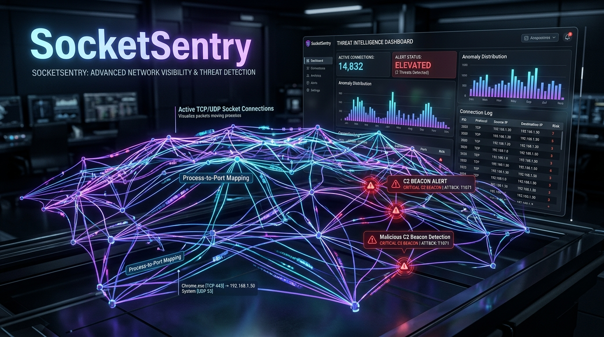
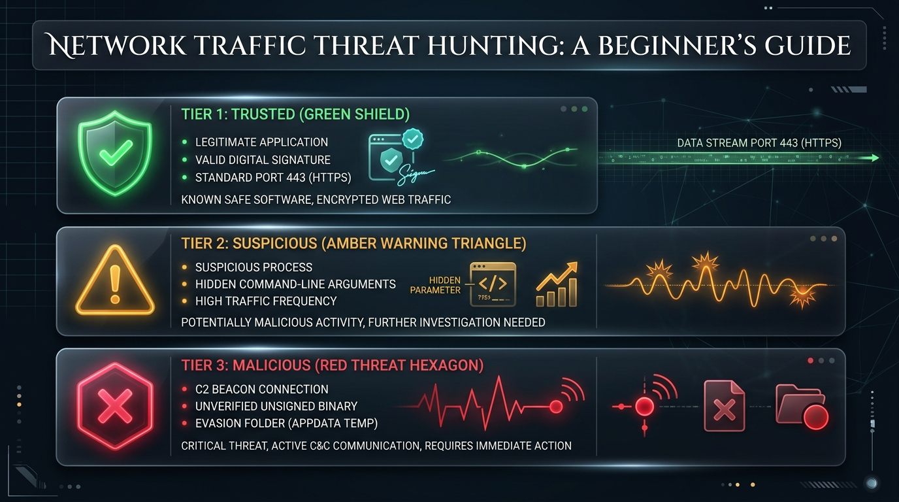
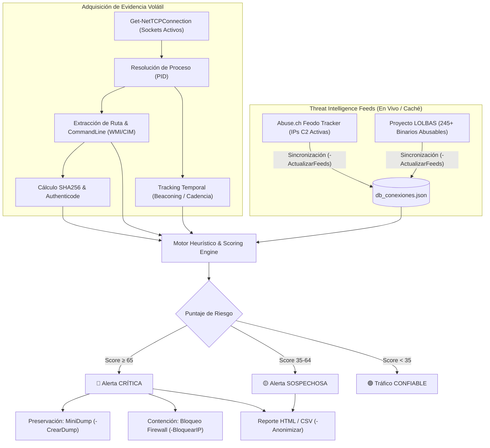

<div align="center">



# 🛡️ SocketSentry
### Framework Forense y Caza de Amenazas en Conexiones de Red para Windows
**Desarrollado por [Cru9](https://github.com/Cru9) | Ecosistema WinAudit-DFIR**

[](https://github.com/Cru9/WinAudit-DFIR)
[](https://www.python.org/)
[](#)
[](#)
[](#)
[](#)
[](./LICENSE)
[](#)

</div>

Framework forense en **Python 3 y PowerShell** para inspección de sockets de red en tiempo real, detección de canales Command & Control (C2), correlación con **Threat Intelligence feeds abiertos (Abuse.ch Feodo Tracker y Proyecto LOLBAS)**, detección de balizas periódicas (*Beaconing*), abuso de binarios legítimos (*Living Off The Land*), ejecutables sin firma digital y comandos maliciosos ofuscados en memoria.

---

## 💡 ¿Para qué sirve esta herramienta? (Explicación para no expertos)

> **En palabras simples:**  
> Es como un **radar de seguridad** que revisa con quién está hablando tu ordenador a través de Internet en este mismo instante. Si hay algún programa desconocido, troyano o virus comunicándose a escondidas con el servidor de un atacante, la herramienta te lo mostrará de inmediato con alertas visuales y claras.

<div align="center">
  
  <p><em>Figura 1: Semáforo visual de clasificación de conexiones y niveles de riesgo para principiantes.</em></p>
</div>

### 🚦 El Semáforo de Seguridad (¿Cómo interpretar lo que ves?)

* 🟢 **Nivel 1: Confiable (Escudo Verde / Trusted):**
  * **¿Qué significa?** Programas cotidianos y seguros (Google Chrome, Microsoft Edge, Steam, Spotify, etc.).
  * **¿Por qué es seguro?** Cuentan con un **sello digital original (Firma Authenticode)** emitido por su fabricante, operan desde rutas protegidas del sistema y usan puertos web normales (como el puerto HTTPS 443).

* 🟡 **Nivel 2: Sospechoso (Triángulo Ámbar / Suspicious):**
  * **¿Qué significa?** Programas que están haciendo cosas atípicas o poco frecuentes.
  * **¿Por qué llama la atención?** Pueden ser scripts de PowerShell que se abren con ventanas invisibles, programas ejecutados desde la carpeta de descargas o temporales (`AppData\Local\Temp`), o procesos que no tienen firma digital verificable comunicándose hacia Internet.

* 🔴 **Nivel 3: Malicioso (Hexágono Rojo / Threat):**
  * **¿Qué significa?** ¡Peligro inminente! Actividad de virus, troyanos o spyware.
  * **¿Por qué alerta en rojo?** La IP a la que intenta conectarse coincide exactamente con servidores de ataque activos catalogados en **Feodo Tracker**, el programa emite balizas periódicas (*C2 Beaconing*), o un binario del sistema fue secuestrado (*LOLBin abuse*).

---

### 📖 Glosario Rápido sin Tecnicismos:
* 🌐 **Conexión Activa:** Cuando un programa en tu equipo está transmitiendo datos hacia una página, juego o servidor en Internet.
* 📡 **Servidor C2 (Comando y Control):** La computadora del atacante que envía órdenes a un virus instalado en tu PC (para robar contraseñas, espiar o descargar más amenazas).
* 🔏 **Firma Digital (Authenticode):** El "sello de autenticidad" que garantiza que un programa fue creado realmente por Microsoft, Google u otra empresa confiable y que nadie lo modificó.
* 🎭 **LOLBin:** Programas oficiales de Windows que los virus intentan engañar o aprovechar para pasar desapercibidos ante los antivirus tradicionales.
* ⏳ **Baliza (*Beaconing*):** Cuando un programa malicioso toca la puerta de un servidor cada cierto tiempo exacto (ej. cada 10 segundos) para avisar que sigue activo.

### 🟢 ¿Cómo usarlo con 1 solo clic? (Modo Principiante)
No necesitas saber de comandos ni de programación:
1. Haz doble clic sobre el archivo **`Ejecutar-Auditoria-Red.bat`**.
2. Pulsa **Sí** en la ventana de permisos de Windows (Administrador).
3. El programa escaneará tu equipo y clasificará tus conexiones en pantalla según el semáforo.
4. Se abrirá automáticamente un informe visual e interactivo en tu navegador (**`Reporte-Conexiones.html`**) con gráficas y métricas claras.

---

## 🎯 Arquitectura y Flujo de Análisis Forense



---

## 🌐 Fuentes de Threat Intelligence Integradas

A diferencia de herramientas basadas únicamente en listas estáticas, **SocketSentry** se alimenta y sincroniza con las principales bases de datos comunitarias abiertas de ciberseguridad:

### 1. Abuse.ch Feodo Tracker (Servidores C2 en Vivo)
* **Qué es:** Proyecto de inteligencia de amenazas de la Universidad de Berna (*abuse.ch*) que rastrea servidores Command and Control (C2) activos de botnets y frameworks de ataque (Cobalt Strike, Emotet, Dridex, QakBot).
* **Acción en el script:** Si una conexión saliente coincide con una IP catalogada en Feodo Tracker, el motor asigna automáticamente **Score 100 (CRÍTICO)** identificando la familia de malware y el Sistema Autónomo (ASN).

### 2. Proyecto Oficial LOLBAS (*Living Off The Land Binaries*)
* **Qué es:** Catálogo oficial comunitario que documenta todos los binarios nativos de Microsoft Windows (`certutil.exe`, `mshta.exe`, `regsvr32.exe`, `bitsadmin.exe`, etc.) que pueden ser abusados por atacantes para descargar payloads o ejecutar código arbitrario evadiendo antivirus.
* **Acción en el script:** El script verifica el nombre del proceso contra más de 245 binarios documentados en LOLBAS y evalúa si mantiene conexiones salientes no autorizadas.

### 3. Heurísticas de Línea de Comandos (CommandLine Rules)
* Inspecciona la línea de comandos completa con la que inició el proceso para cazar:
  * **Comandos en Base64:** `-EncodedCommand`, `-enc`.
  * **Ventanas Ocultas:** `-WindowStyle Hidden`, `-w hidden`.
  * **Cunas de Descarga (Download Cradles):** `DownloadString`, `Invoke-WebRequest`, `IEX`, `curl`.
  * **Evasión de Políticas:** `-ExecutionPolicy Bypass`.

---

## 🚀 Capacidades y Módulos de Respuesta

* **Detección de Balizas C2 (*Beaconing*):** Rastrea las conexiones salientes hacia servidores externos. Si detecta intervalos regulares y periódicos (ej. cada $X$ segundos con bajo margen de variación), alerta sobre comunicación de baliza C2.
* **Preservación Forense Automatizada (`-CrearDump`):** Ante conexiones críticas o sospechosas, genera un mini-volcado de proceso (`.dmp`) mediante el manejador nativo `comsvcs.dll` de Windows, asegurando la memoria RAM antes de que el proceso sea terminado o desconectado.
* **Contención Activa en Firewall (`-BloquearIP`):** Crea de forma inmediata una regla de bloqueo saliente en Windows Defender Firewall ante la detección de IPs C2 críticas.
* **Modo de Privacidad y Anonimización (`-Anonimizar`):** Enmascara nombres de host locales (`WORKSTATION`) y rutas de usuario (`C:\Users\Usuario\...`) en reportes exportados, permitiendo compartir evidencia o publicar informes sin fugas de datos personales.

---

## 📊 Matriz de Evaluación de Riesgo (Risk Scoring)

| Factor Evaluado | Puntos | Justificación Forense |
| :--- | :---: | :--- |
| **Coincidencia IOC en Abuse.ch Feodo Tracker** | `+75` | IP confirmada como servidor C2 activo en feeds de Threat Intel globales. |
| **Suplantación de Identidad (*Masquerading*)** | `+55` | Proceso del sistema (ej. `svchost.exe`) operando fuera de `System32`. |
| **Puerto C2 Conocido (`4444`, `50050`, `1337`)** | `+45 a +50` | Puertos por defecto de Metasploit, Cobalt Strike, BackOrifice o RATs. |
| **Ubicación en `%TEMP%` o `\Windows\Temp`** | `+40` | Carpetas temporales utilizadas comúnmente por droppers y malware. |
| **Comando Ofuscado / Base64 / IEX en CommandLine** | `+35` | Argumentos en memoria típicos de inyección o ejecución sin tocar disco. |
| **LOLBin con Conexión Saliente a Internet** | `+35 a +45` | Binario de LOLBAS comunicándose con servidores remotos. |
| **Detección de Beaconing C2 (Cadencia Cíclica)** | `+30` | Conexiones repetitivas hacia el mismo destino en modo monitor. |
| **Binario Sin Firma Digital (Hacia Internet)** | `+30` | Ejecutable no firmado comunicándose con el exterior. |
| **Firma Digital Válida de Fabricante Confiable** | `-30` | Proceso firmado por Microsoft, Google, Mozilla, Valve, etc. en ruta legítima. |

---

## 💻 Modos de Ejecución

### 1. Lanzador Inteligente (.bat) — *Recomendado*
El script detecta automáticamente si cuentas con **Python 3** en el sistema; de ser así, inicializa el motor analítico de Python. En caso contrario, conmuta de forma transparente hacia el motor nativo de **PowerShell**.

```cmd
Ejecutar-SocketSentry.bat
```
*(Solicita automáticamente permisos de Administrador vía UAC sin bucles de ventanas).*

---

### 2. Ejecución Directa en Python (`.py`)
Compatible con Python 3.8+ sin librerías externas obligatorias de terceros (`pip`).

#### Menú Interactivo Completo:
```cmd
python SocketSentry.py
```

#### Modo Automatizado / Headless (Ideal para Triage Centralizado):
```cmd
# Escaneo de conexiones activas con generación de HTML y JSON:
python SocketSentry.py --scan --html --json

# Filtrar exclusivamente conexiones sospechosas o críticas:
python SocketSentry.py --suspicious-only

# Centinela en tiempo real (Monitor continuo de balizas C2):
python SocketSentry.py --monitor

# Inyectar conexiones de prueba para demostración (Metasploit, Cobalt Strike):
python SocketSentry.py --simulate --html
```

---

### 3. Motor Nativo en PowerShell (`.ps1`)
Para entornos corporativos donde no se permite instalar Python o en consolas de administración:

```powershell
.\SocketSentry.ps1
```
*(O llamando directamente al motor avanzado: `.\Auditar-Conexiones.ps1 -SoloSospechosas`)*

1. **Sincronizar Feeds de Inteligencia de Amenazas (Recomendado):**
   *Descarga las IPs de C2 activas de Abuse.ch y el catálogo oficial de LOLBAS:*
   ```powershell
   .\Auditar-Conexiones.ps1 -ActualizarFeeds
   ```

2. **Auditoría estándar con resolución DNS:**
   ```powershell
   .\Auditar-Conexiones.ps1 -ResolverDNS
   ```

3. **Modo Demostración (`-SimularSospechoso`):**
   *Inyecta conexiones de prueba realistas (troyano en Temp, proceso suplantado en puerto 50050 y PowerShell con comando oculto) para verificar las alertas:*
   ```powershell
   .\Auditar-Conexiones.ps1 -SimularSospechoso -SoloSospechosas
   ```

4. **Preservación Forense (MiniDump) ante sospecha:**
   *Genera un archivo `.dmp` de los procesos sospechosos en la carpeta `Dumps/`:*
   ```powershell
   .\Auditar-Conexiones.ps1 -SoloSospechosas -CrearDump
   ```

5. **Modo Centinela con Bloqueo Activo en Firewall:**
   *Monitorea continuamente cada 5 segundos y bloquea IPs críticas automáticamente:*
   ```powershell
   .\Auditar-Conexiones.ps1 -Monitor -IntervaloSegundos 5 -BloquearIP
   ```

6. **Exportar Informe Forense con Anonimización Activa:**
   ```powershell
   .\Auditar-Conexiones.ps1 -ExportarHTML .\Reporte-Forense.html -ExportarCSV .\Evidencia.csv -Anonimizar
   ```

---

## 🗄️ Estructura del Repositorio

* [`Auditar-Conexiones.ps1`](./Auditar-Conexiones.ps1): Script principal de recolección, correlación WMI/CIM, motor de scoring, MiniDump y Firewall.
* [`db_conexiones.json`](./db_conexiones.json): Base de datos local persistida con reglas heurísticas, LOLBins y caché de IOCs C2.
* [`Ejecutar-Auditoria-Red.bat`](./Ejecutar-Auditoria-Red.bat): Lanzador con auto-elevación a Administrador (1 solo clic).
* [`assets/`](./assets/): Banners, diagramas conceptuales e infografías educativas.
* [`CONTRIBUTING.md`](./CONTRIBUTING.md): Guía comunitaria para reportar falsos positivos y colaborar con nuevas reglas.
* [`SECURITY.md`](./SECURITY.md): Política de seguridad, divulgación responsable y descargo ético.
* `Reporte-Conexiones.html`: Dashboard visual interactivo generado automáticamente en cada escaneo (*ignorado por `.gitignore` para no exponer datos privados*).
* [`.github/workflows/lint.yml`](./.github/workflows/lint.yml): Integración continua de calidad de código con `PSScriptAnalyzer`.
* [`.github/ISSUE_TEMPLATE/`](./.github/ISSUE_TEMPLATE/): Plantillas estructuradas de GitHub para incidencias y nuevas heurísticas.
* [`LICENSE`](./LICENSE): Licencia de código abierto MIT.

---

## ❓ Preguntas Frecuentes (FAQ) y Solución de Problemas

<details>
<summary><b>1. PowerShell muestra el error: "La ejecución de scripts está deshabilitada en este sistema"</b></summary>
<br>

Es una medida de seguridad predeterminada de Windows para cuentas de usuario. Puedes resolverlo de dos formas:
1. **La más fácil:** Simplemente haz doble clic en el archivo **`Ejecutar-Auditoria-Red.bat`**, el cual automáticamente habilita la ejecución en modo bypass temporal para esa sesión.
2. **Desde PowerShell:** Abre PowerShell como Administrador y ejecuta:
   ```powershell
   Set-ExecutionPolicy RemoteSigned -Scope CurrentUser
   ```
</details>

<details>
<summary><b>2. ¿La herramienta funciona sin conexión a Internet (Modo Offline / Air-Gapped)?</b></summary>
<br>

**Sí, al 100%.** Toda la inteligencia básica, firmas de evasión, puertos sospechosos y el catálogo de más de 245 binarios de LOLBAS vienen empaquetados localmente dentro de `db_conexiones.json`. El script únicamente se conectará a Internet si utilizas explícitamente el parámetro `-ActualizarFeeds` para descargar las últimas IPs de Feodo Tracker.
</details>

<details>
<summary><b>3. ¿La auditoría altera, bloquea o borra algún archivo de mi sistema?</b></summary>
<br>

**No.** Por defecto, SocketSentry opera en modo de **solo lectura e inspección forense**. No modifica el registro, no altera tus archivos ni interrumpe conexiones. La única excepción es si ejecutas voluntariamente el parámetro de respuesta activa `-BloquearIP`, el cual crea una regla de bloqueo saliente en el Firewall de Windows para contener una amenaza crítica.
</details>

<details>
<summary><b>4. ¿Qué debo hacer si un programa legítimo de mi trabajo sale marcado en amarillo o rojo?</b></summary>
<br>

Se trata de un posible **falso positivo** (por ejemplo, software interno o drivers sin firma comercial). Puedes verificar el hash SHA256 en VirusTotal o abrir un reporte en nuestro GitHub utilizando la plantilla de [Reporte de Falso Positivo](./.github/ISSUE_TEMPLATE/falso_positivo.yml) para que sea incorporado en la lista de exclusiones de la comunidad.
</details>

---

## 🛡️ Protocolo Forense ante Alerta Confirmada

1. **Aislar de la red:** Desconectar cable Ethernet y apagar Wi-Fi de inmediato para interrumpir el canal C2.
2. **NO reiniciar ni apagar el equipo:** Apagar la máquina destruirá la memoria RAM, los sockets volátiles en memoria y claves criptográficas efímeras.
3. **Preservar memoria volátil:** Generar volcado con `-CrearDump` o desde el Administrador de Tareas.
4. **Validación Externa:**
   * Comprobar el hash SHA256 reportado en [VirusTotal](https://www.virustotal.com/).
   * Consultar la IP remota en [AbuseIPDB](https://www.abuseipdb.com/).

---

## 📂 Estructura del Repositorio

```text
SocketSentry/
│
├── SocketSentry.py                 # Core analítico en Python 3 (CLI + GUI Dashboard + Beacon Hunter)
├── SocketSentry.ps1                # Motor nativo avanzado en PowerShell 5.1+/7+
├── Auditar-Conexiones.ps1          # Motor original de análisis forense y respuesta activa
├── Ejecutar-SocketSentry.bat       # Lanzador inteligente multi-runtime con UAC
├── Ejecutar-Auditoria-Red.bat      # Script de compatibilidad retrocompatible
├── Cerrar-Ventanas-SocketSentry.bat# Script de limpieza y detención de procesos
├── db_conexiones.json              # Base de datos local de amenazas (LOLBAS, Feodo C2, puertos)
├── LICENSE                         # Licencia MIT (Cru9)
├── SECURITY.md                     # Política de seguridad y uso responsable
├── CONTRIBUTING.md                 # Guía para desarrolladores
├── .gitignore                      # Reglas de exclusión de git
│
├── 📁 assets/                      # Banners e infografías de alta resolución
│   ├── banner.jpg
│   └── threat_matrix_guide.jpg
│
└── 📁 Reportes/                    # Almacenamiento de reportes y dashboard demo
    └── SocketSentry_Dashboard_Demo.html
```

---

## ⚖️ Descargo de Responsabilidad Ético (Disclaimer)

Esta herramienta ha sido desarrollada con fines estrictamente **educativos, de auditoría de seguridad defensiva y respuesta ante incidentes (DFIR)**. El uso de esta herramienta en sistemas sin autorización expresa de sus propietarios está prohibido. Los desarrolladores no asumen responsabilidad alguna por el mal uso o daños resultantes de su ejecución.

---

## 📜 Licencia

Distribuido bajo la Licencia **MIT**. Consulta [`LICENSE`](./LICENSE) para más información.
