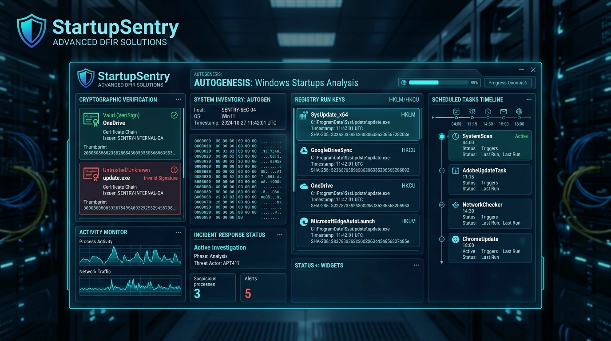

<div align="center">



# 🚀 StartupSentry
### Framework Forense de Persistencia en Inicio, Tareas Programadas y Firmas Authenticode
**Desarrollado por [Cru9](https://github.com/Cru9) | Ecosistema WinAudit-DFIR**

[](https://github.com/Cru9/WinAudit-DFIR)
[](https://www.python.org/)
[](#)
[](#)
[](#)
[](#)
[](./LICENSE)

</div>

**StartupSentry** es un framework de **Threat Hunting y Triage Forense (DFIR)** en arquitectura dual (**Python 3 y PowerShell nativo**) diseñado para descubrir, auditar y neutralizar mecanismos de persistencia furtiva en Windows. Inspecciona programas de auto-arranque (`Win32_StartupCommand`, claves del Registro `Run`/`RunOnce`), tareas programadas en la raíz del sistema (`\`) no pertenecientes a Microsoft, gatillos recurrentes de alta frecuencia y valida criptográficamente cada binario mediante firmas digitales **Authenticode**.

---

## 💡 ¿Para qué sirve esta herramienta? (Explicación para no expertos)

> **En palabras simples:**  
> Cuando un virus, troyano o atacante infecta un ordenador, su primer objetivo es **sobrevivir a los reinicios**. Para lograrlo, se oculta en los programas que inician con Windows o crea tareas automáticas para ejecutarse cada pocos minutos.  
> **StartupSentry** examina con lupa cada rincón del arranque, comprueba si los programas tienen el sello digital legítimo de su creador y te avisa de inmediato si hay algo sospechoso o manipulado.

---

### 🚦 El Semáforo de Persistencia (¿Cómo interpretar lo que ves?)

* 🟢 **Nivel 1: Confiable (Firma Válida / Valid):**
  * **¿Qué significa?** Programas legítimos de fabricantes reconocidos (Google, Microsoft, Riot Games, Docker, etc.).
  * **¿Por qué es seguro?** Poseen una **firma digital Authenticode íntegra**, residen en carpetas estándar (`Program Files`, `System32`) y no utilizan parámetros de ejecución ofuscados.

* 🟡 **Nivel 2: Sospechoso (Alerta / Warning):**
  * **¿Qué significa?** Programas que arrancan con Windows pero presentan comportamientos inusuales.
  * **¿Por qué alerta?** Ejecutables alojados en carpetas de usuario o temporales (`AppData\Local`, `Temp`, `Users\Public`), binarios sin firma digital (`NotSigned`), o tareas programadas con repeticiones periódicas de menos de 30 minutos (`PT5M`, `PT15M`).

* 🔴 **Nivel 3: Crítico (Amenaza Inminente / Critical):**
  * **¿Qué significa?** Alta probabilidad de malware, troyano o persistencia activa de un atacante.
  * **¿Por qué alerta en rojo?** 
    1. **Firma Corrupta (`HashMismatch`):** El archivo fue modificado tras ser firmado (síntoma de malware o inyección de código).
    2. **Suplantación de Identidad (*Masquerading*):** Nombres de procesos críticos del sistema (`svchost.exe`, `explorer.exe`, `lsass.exe`) ejecutándose fuera de `C:\Windows\System32`.
    3. **Comandos Ocultos / LOLBins:** Uso de `powershell -enc`, `cmd /c`, `wscript`, `mshta` o descargas remotas (`curl`, `certutil -urlcache`, `downloadstring`) configuradas para iniciar con el sistema.

---

## 🎯 Cobertura Táctica MITRE ATT&CK

| Táctica MITRE | Técnica / Subtécnica | ID MITRE | Detección en StartupSentry |
| :--- | :--- | :--- | :--- |
| **Persistencia** | Registry Run Keys / Startup Folder | [`T1547.001`](https://attack.mitre.org/techniques/T1547/001/) | Auditoría de `Win32_StartupCommand`, carpetas Startup y claves directas en `HKLM/HKCU:Run` |
| **Persistencia / Ejecución** | Scheduled Task/Job | [`T1053.005`](https://attack.mitre.org/techniques/T1053/005/) | Tareas en raíz `\` no-Microsoft y detección de intervalos recurrentes (`<= 30 min`) |
| **Evasión de Defensa** | Subvert Trust Controls: Code Signing | [`T1553.002`](https://attack.mitre.org/techniques/T1553/002/) | Validación criptográfica Authenticode (`Valid`, `NotSigned`, `HashMismatch`) |
| **Evasión de Defensa** | Masquerading: Match Legitimate Name | [`T1036.005`](https://attack.mitre.org/techniques/T1036/005/) | Binarios simulando ejecutables de Windows fuera de `System32` / `SysWOW64` |
| **Ejecución / Evasión** | System Binary Proxy Execution (LOLBins) | [`T1218`](https://attack.mitre.org/techniques/T1218/) | Detección de `powershell.exe`, `cmd.exe`, `mshta`, `rundll32`, `wscript` en tareas y arranque |

---

## 📁 Estructura del Módulo

```text
StartupSentry/
│
├── StartupSentry.py            # Motor central en Python 3 (CLI + Dashboard HTML Cyberpunk)
├── StartupSentry.ps1           # Motor forense nativo en PowerShell 5.1+/7+ (Authenticode)
├── Ejecutar-StartupSentry.bat  # Lanzador inteligente multi-runtime con auto-elevación UAC
├── Cerrar-Ventanas-StartupSentry.bat # Detención limpia de ventanas y procesos en background
├── .gitignore                  # Exclusión de evidencias y reportes del control de versiones
├── LICENSE                     # Licencia MIT (Cru9)
├── SECURITY.md                 # Política de divulgación responsable
├── CONTRIBUTING.md             # Guía de contribución técnica
├── README.md                   # Documentación técnica y operacional
│
├── Reportes/                   # Directorio local de evidencias
│   ├── .gitkeep
│   ├── StartupSentry_Audit_*.json     # Exportación estructurada forense
│   ├── StartupSentry_Audit_*.csv      # Tablas de datos para analistas
│   └── StartupSentry_Dashboard_*.html # Dashboard ejecutivo interactivo
│
└── assets/                     # Recursos gráficos y multimedia
    └── banner.jpg              # Banner visual HUD de alta resolución
```

---

## 🚀 Guía de Inicio Rápido

### Opción 1: Ejecución con 1 solo clic (Recomendada)
1. Haz doble clic en **`Ejecutar-StartupSentry.bat`**.
2. Confirma los privilegios de Administrador en el diálogo UAC de Windows.
3. El lanzador detectará automáticamente si tienes Python 3 instalado para cargar la consola interactiva, o iniciará directamente el motor nativo en PowerShell.

### Opción 2: Motor Python 3 (Consola Interactiva)
```powershell
python StartupSentry.py
```
*Ofrece menú interactivo [1-6], filtros dinámicos, exportación a JSON/CSV y apertura automática del Dashboard HTML Cyberpunk.*

### Opción 3: Motor Nativo PowerShell (Sin Dependencias)
```powershell
# Ejecución completa con visualización en consola
powershell -ExecutionPolicy Bypass -File .\StartupSentry.ps1

# Filtrar únicamente elementos sospechosos o alertas
powershell -ExecutionPolicy Bypass -File .\StartupSentry.ps1 -SoloSospechosos

# Exportar datos a JSON o CSV
powershell -ExecutionPolicy Bypass -File .\StartupSentry.ps1 -ExportarCSV "Reportes\persistencia.csv"
powershell -ExecutionPolicy Bypass -File .\StartupSentry.ps1 -ExportarJSON "Reportes\persistencia.json"
```

---

## 📊 Dashboard Ejecutivo Cyberpunk

Al seleccionar la opción `[5]` en el menú de Python o ejecutar el análisis, **StartupSentry** genera un reporte HTML autónomo de estética **Cyberpunk Glassmorphism**:
* 🎛️ **KPI Cards en Vivo:** Total de entradas evaluadas, firmas válidas, alertas activas y Threat Score global (0 a 100).
* 🛡️ **Matriz MITRE ATT&CK:** Visualización táctica de técnicas de persistencia y evasión mapeadas.
* 🔎 **Buscador Instantáneo:** Filtrado en tiempo real por nombre, comando, ruta o firmante.
* 📋 **Tabla de Auditoría:** Clasificación cromática por severidad (`CRÍTICA`, `ALTA`, `MEDIA`, `BAJA`) y estado de firma Authenticode.

---

## ⚖️ Licencia y Autoría

Desarrollado por **Ezequiel Diaz (Cru9)** como componente integral de la **WinAudit-DFIR Suite**.  
Distribuido bajo la Licencia **MIT**. Consulte el archivo `LICENSE` en la raíz del proyecto para más detalles.
