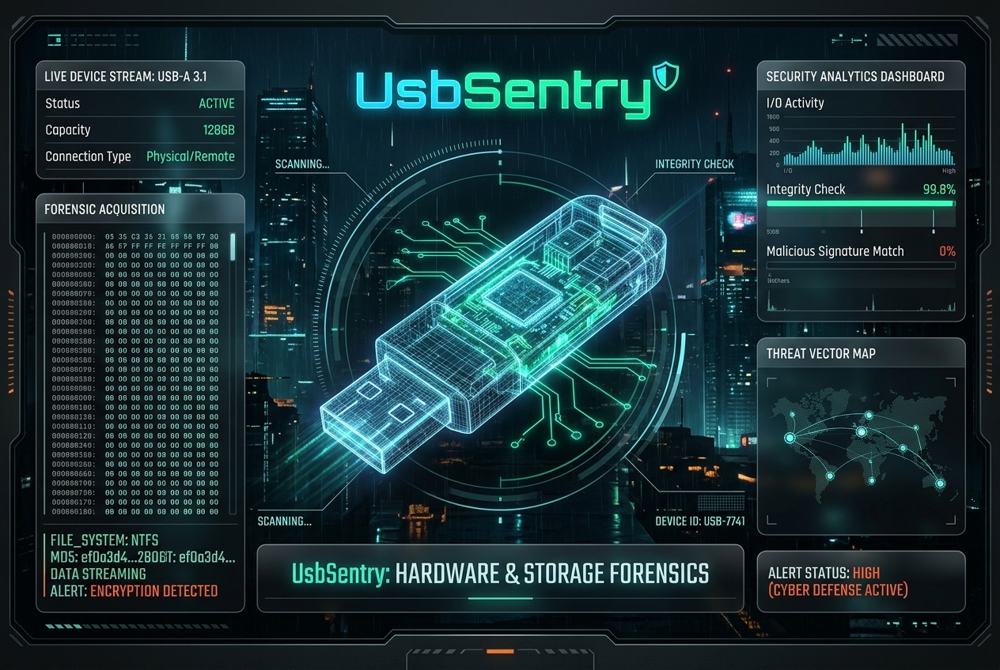

<div align="center">



# 💾 UsbSentry
### Framework Forense de Dispositivos USB, Exfiltración Física y BadUSB Hunter
**Desarrollado por [Cru9](https://github.com/Cru9) | Ecosistema WinAudit-DFIR**

[](https://github.com/Cru9/WinAudit-DFIR)
[](https://www.python.org/)
[](#)
[](#)
[](#)
[](#)
[](./LICENSE)

</div>

**UsbSentry** es un framework de **Respuesta a Incidentes y Triage Forense (DFIR)** en arquitectura dual (**Python 3 y PowerShell nativo**) diseñado para descubrir, auditar y reconstruir la línea de tiempo de cualquier memoria USB, disco extraíble o dispositivo malicioso conectado a un equipo Windows. Correlaciona claves del registro (`USBSTOR`, `MountedDevices`, `USB`), identifica números de serie únicos de hardware, letras de unidad asignadas y caza activamente dispositivos de inyección de pulsaciones (*BadUSB*, *Rubber Ducky*, *Bash Bunny*, *Flipper Zero*).

---

## 💡 ¿Para qué sirve esta herramienta? (Explicación para no expertos)

> **En palabras simples:**  
> Cuando un empleado desleal roba información en una memoria USB, o un atacante conecta un dispositivo espía para hackear tu PC en segundos (*BadUSB*), Windows guarda un registro imborrable de ese aparato.  
> **UsbSentry** lee esos registros ocultos, te dice exactamente la **marca, modelo, número de serie único y qué letra de unidad (ej. E:, F:) tuvo**, cuándo se conectó por última vez y si se trataba de una memoria normal o de un dispositivo malicioso.

---

### 🚦 El Semáforo Forense de Dispositivos USB

* 🟢 **Nivel 1: Confiable (Normal / Trusted):**
  * **¿Qué significa?** Memorias USB estándar de fabricantes de confianza (SanDisk, Kingston, Samsung, HP, Western Digital).
  * **¿Por qué es seguro?** Cuentan con un **número de serie de hardware único de fábrica**, descriptores USB estándar y no presentan comportamientos anómalos.

* 🟡 **Nivel 2: Sospechoso (Alerta Heurística / Warning):**
  * **¿Qué significa?** Dispositivos con características inusuales o clonadas.
  * **¿Por qué alerta?** 
    1. **Sin serial único de fábrica:** Dispositivos cuyo serial contiene caracteres de autogeneración (`&0`, `&_&`), típico de memorias chinas genéricas, falsificaciones o microcontroladores clonados.
    2. **Fabricante no identificado:** Dispositivos sin Vendor ID (VID) registrado en los estándares USB.
    3. **Actividad Reciente:** Conexiones efectuadas en las últimas 48 horas durante una investigación en curso.

* 🔴 **Nivel 3: Crítico (Amenaza Inminente / BadUSB):**
  * **¿Qué significa?** ¡Alerta máxima! Dispositivo de ataque físico o exfiltración activa.
  * **¿Por qué alerta en rojo?** 
    1. **Firma BadUSB Detectada:** Coincidencia exacta con identificadores de hardware de herramientas de intrusión física (**Hak5 USB Rubber Ducky, Bash Bunny, Flipper Zero, emuladores Arduino/Raspberry Pi Pico HID**).
    2. **Dispositivos Compuestos Ocultos:** Memorias que se hacen pasar simultáneamente por teclados para inyectar código en la terminal a la velocidad de la luz.

---

## 🎯 Cobertura Táctica MITRE ATT&CK®

| Táctica MITRE | Técnica / Subtécnica | ID MITRE | Detección en UsbSentry |
| :--- | :--- | :--- | :--- |
| **Exfiltración** | Exfiltration Over Physical Medium | [`T1052.001`](https://attack.mitre.org/techniques/T1052/001/) | Auditoría de dispositivos USBSTOR y letras de unidad asignadas para fuga de datos |
| **Acceso Inicial / Ejecución** | Hardware Additions (BadUSB) | [`T1200`](https://attack.mitre.org/techniques/T1200/) | Detección de identificadores de inyectores de teclado (Rubber Ducky / Flipper Zero) |
| **Movimiento Lateral** | Replication Through Removable Media | [`T1091`](https://attack.mitre.org/techniques/T1091/) | Rastreo de memorias USB usadas para propagación de gusanos o ransomware en redes aisladas |
| **Recolección** | Data from Removable Media | [`T1025`](https://attack.mitre.org/techniques/T1025/) | Identificación de particiones y unidades montadas en el host |

---

## 📁 Estructura del Módulo

```text
UsbSentry/
│
├── UsbSentry.py                 # Motor central en Python 3 (CLI + Dashboard HTML Cyberpunk)
├── UsbSentry.ps1                # Motor forense nativo en PowerShell 5.1+/7+
├── Ejecutar-UsbSentry.bat       # Lanzador inteligente multi-runtime con auto-elevación UAC
├── Cerrar-Ventanas-UsbSentry.bat# Detención limpia de ventanas y procesos en background
├── .gitignore                   # Exclusión de evidencias y reportes del control de versiones
├── LICENSE                      # Licencia MIT (Cru9)
├── SECURITY.md                  # Política de divulgación responsable de vulnerabilidades
├── CONTRIBUTING.md              # Guía de contribución para analistas y desarrolladores
├── README.md                    # Documentación técnica y operacional
│
├── Reportes/                    # Directorio local de evidencias
│   ├── .gitkeep
│   ├── UsbSentry_Dashboard_Demo.html  # Dashboard interactivo de muestra
│   ├── UsbSentry_Audit_*.json         # Exportación estructurada forense
│   └── UsbSentry_Audit_*.csv          # Tablas de datos para peritajes
│
└── assets/                      # Recursos multimedia
    └── banner.jpg               # Banner visual HUD en alta resolución
```

---

## 🚀 Guía de Inicio Rápido

### Opción 1: Ejecución con 1 solo clic (Recomendada)
1. Haz doble clic en **`Ejecutar-UsbSentry.bat`**.
2. Confirma los privilegios de Administrador en el diálogo UAC de Windows.
3. El lanzador detectará automáticamente si tienes Python 3 instalado para cargar la consola interactiva, o iniciará directamente el motor nativo en PowerShell.

### Opción 2: Motor Python 3 (Consola Interactiva)
```powershell
python UsbSentry.py
```
*Ofrece menú interactivo [1-6], filtros dinámicos, exportación a JSON/CSV y apertura automática del Dashboard HTML Cyberpunk.*

### Opción 3: Motor Nativo PowerShell (Sin Dependencias)
```powershell
# Ejecución completa con visualización en consola
powershell -ExecutionPolicy Bypass -File .\UsbSentry.ps1

# Filtrar únicamente elementos sospechosos o BadUSB
powershell -ExecutionPolicy Bypass -File .\UsbSentry.ps1 -SoloSospechosos

# Filtrar únicamente dispositivos conectados en vivo
powershell -ExecutionPolicy Bypass -File .\UsbSentry.ps1 -SoloConectados

# Exportar datos a JSON o CSV
powershell -ExecutionPolicy Bypass -File .\UsbSentry.ps1 -ExportarCSV "Reportes\usb_evidencias.csv"
powershell -ExecutionPolicy Bypass -File .\UsbSentry.ps1 -ExportarJSON "Reportes\usb_evidencias.json"
```

---

## 📊 Dashboard Ejecutivo Cyberpunk

Al seleccionar la opción `[4]` en el menú de Python o ejecutar con el flag `--html`, **UsbSentry** genera un reporte HTML autónomo de estética **Cyberpunk Glassmorphism**:
* 🎛️ **KPI Cards en Vivo:** Total de dispositivos registrados, memorias conectadas en vivo, alertas activas y Threat Score global de almacenamiento.
* 🛡️ **Matriz MITRE ATT&CK:** Visualización táctica de técnicas de exfiltración física y hardware additions.
* 🔎 **Buscador Instantáneo:** Filtrado en tiempo real por nombre, serial, fabricante o letra de unidad.
* 📋 **Tabla de Auditoría:** Clasificación cromática por severidad (`CRÍTICA`, `SOSPECHOSA`, `CONFIABLE`) y estado (`CONECTADO (LIVE)` vs `HISTÓRICO`).

---

## ⚖️ Licencia y Autoría

Desarrollado por **Ezequiel Diaz (Cru9)** como componente integral de la **WinAudit-DFIR Suite**.  
Distribuido bajo la Licencia **MIT**. Consulte el archivo `LICENSE` para más detalles.
