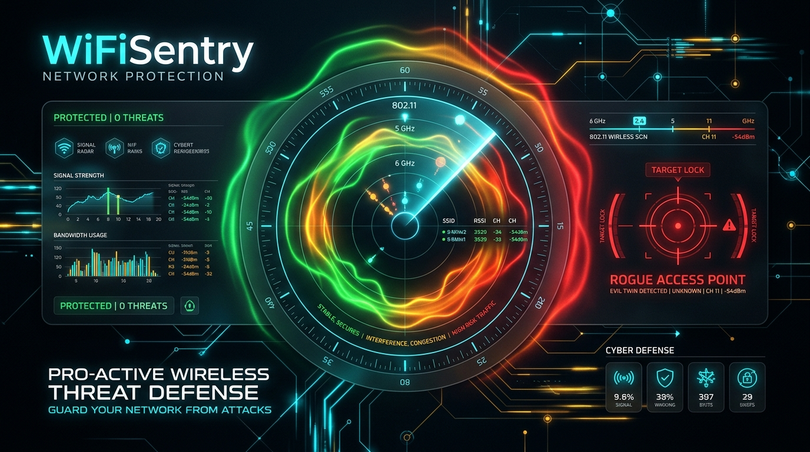
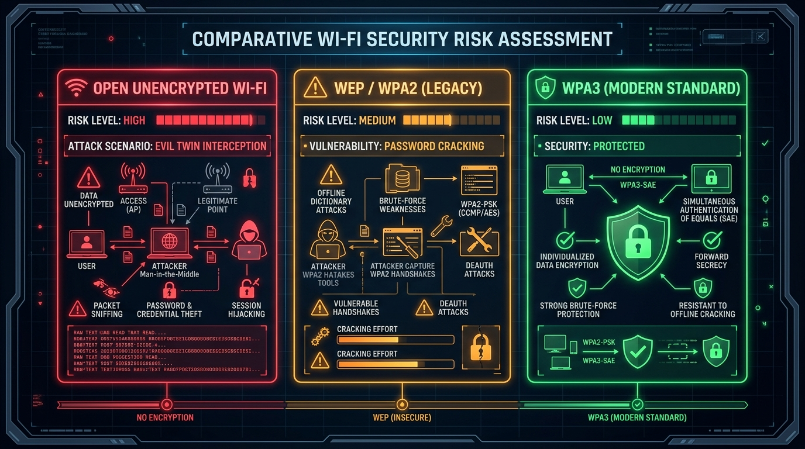

<div align="center">



# 🛡️ WiFiSentry v3.0.0
### Suite DFIR de Auditoría WLAN, Radar Evil Twin & Mapa de Calor en Tiempo Real

[](https://github.com/Cru9/WinAudit-DFIR)
[](#)
[](#)
[](#)
[](./LICENSE)
[](#)
[](https://github.com/Cru9)

</div>

**WiFiSentry** es un framework integral de auditoría inalámbrica, respuesta ante incidentes (DFIR) y manual interactivo de hardening defensivo. Está diseñado para ser intuitivo y educativo para estudiantes y entusiastas que están aprendiendo redes, al tiempo que proporciona la profundidad técnica, telemetría y rigor analítico que exigen los analistas de seguridad y administradores de sistemas.

Permite auditar perfiles WLAN almacenados en Windows (protegidos por DPAPI), cazar en tiempo real ataques de gemelos malvados (**Evil Twin / Rogue AP**) mediante análisis de tramas beacon y BSSID, visualizar **Mapas de Calor Wi-Fi en Tiempo Real** (sensores de proximidad RF, RSSI en dBm y saturación de canales), auditar la entropía criptográfica de contraseñas con estimaciones realistas de crackeo por GPU (**Hashcat / Aircrack-ng**) y exportar dashboards ejecutivos interactivos en estilo dark cyberpunk.

Forma parte del ecosistema de ciberseguridad y redes de [Cru9](https://github.com/Cru9), junto con [SocketSentry](https://github.com/Cru9/SocketSentry), [WinAudit-DFIR](https://github.com/Cru9/WinAudit-DFIR) e [IP_Scan_Tools](https://github.com/Cru9/IP_Scan_Tools-main).

---

## 🌟 Novedades Principales en la Versión 1.2

1. 📡 **Radar Evil Twin en Vivo (Rogue AP Hunter):**
   * Escaneo de puntos de acceso cercanos (2.4 GHz, 5 GHz y 6 GHz) extrayendo BSSID (dirección MAC), canal, señal (%) y suite de cifrado.
   * Detección activa de ataques de degradación (*Downgrade Attacks*) y puntos de acceso abiertos que intentan suplantar redes corporativas o domésticas guardadas.
2. 🔥 **Mapa de Calor Wi-Fi en Tiempo Real (Heatmap de Señal & Proximidad RSSI):**
   * Bucle continuo de telemetría RF en vivo con refresco cada 2.5 segundos y control de salida inmediata con tecla `Q` o `ESC`.
   * Estimación de RSSI en dBm ($RSSI \approx \text{Señal}/2 - 100$) y distancia física estimada a la fuente emisora.
   * Rastreo de variaciones de señal ($\Delta \pm\%$) para detectar si un atacante físico con una antena o Rogue AP portátil se está aproximando.
   * Semáforo térmico (Zona Crítica $>80\%$, Alta $65-79\%$, Media $45-64\%$, Baja $25-44\%$, Fría $<25\%$) y barras de congestión por canal.
3. 🔐 **Calculadora de Entropía Criptográfica & Benchmark de Crackeo GPU:**
   * Cálculo de entropía en bits de Shannon ($E = L \times \log_2 R$).
   * Identificación heurística de patrones vulnerables (claves de fábrica ISP de 8 caracteres hex, secuencias numéricas de 10 dígitos, etc.).
   * Estimaciones de tiempo de crackeo offline para WPA2 PBKDF2 (4,096 iteraciones) comparando: **CPU Multi-Core**, **NVIDIA RTX 3060**, **NVIDIA RTX 4090** y **Cluster en la Nube (8x RTX 4090)**.
4. 💻 **Dashboard HTML Cyberpunk Interactivo con Simulador en Vivo:**
   * Interfaz web con pestañas (*tabs*), mapa de calor espectral dinámico con **botón de pulso térmico en vivo**, velocímetro de entropía, tabla con búsqueda en vivo y copiado rápido al portapapeles.

---

## 💡 ¿Para qué sirve esta herramienta? (Explicación para no expertos)

> [!NOTE]
> **En palabras simples:**  
> Tu ordenador guarda en su memoria la contraseña de **cada red Wi-Fi a la que te has conectado en tu vida** (tu casa, tu oficina, hoteles, aeropuertos y cafeterías). Si dejas tu portátil desbloqueado tan solo 10 segundos, cualquier persona puede ver todas tus contraseñas en texto claro sin pedir contraseñas de administrador.
>
> Además, tu ordenador va por la calle gritando al aire las redes que conoce buscando conectarse. Los ciberdelincuentes usan antenas para escuchar esos gritos y crear redes trampa falsas (**Ataque Evil Twin**) para que tu equipo se conecte sin que lo notes y te roben tus datos.
>
> **WiFiSentry** te protege: te avisa si hay redes trampa cerca, te muestra un **mapa de calor en vivo** para saber qué tan cerca está cada red a tu alrededor, calcula qué tan fácil sería adivinar tus contraseñas y te ayuda a borrar redes viejas con 1 solo clic.

<div align="center">
  
  <p><em>Figura 1: Semáforo comparativo de tecnologías Wi-Fi y vectores de intercepción (Evil Twin vs Fuerza Bruta vs WPA3 SAE).</em></p>
</div>

---

## 🔥 Sistema de Mapa de Calor Wi-Fi en Tiempo Real (Heatmap & Proximidad)

El mapa de calor opera como un radar espectral en consola que actualiza cada 2.5 segundos la potencia recibida de radiofrecuencia:

```text
==========================================================================================
  MAPA DE CALOR WI-FI EN TIEMPO REAL (SENSOR DE PROXIMIDAD & RSSI TERMICO)
==========================================================================================
  Barrido #8 | Hora: 19:15:30 | Refresco: 2.5s | [Presiona 'Q' o ESC para salir]
==========================================================================================

  [+] Puntos de Acceso detectados: 32 | Fuente mas intensa: Red Deco (87%)
---------------------------------------------------------------------------------------------------------
SSID               BSSID (MAC)        CH    BANDA    SENAL  EST.RSSI  CALOR       DELTA    BARRA TERMICA (HEATMAP)
---------------------------------------------------------------------------------------------------------
Red Deco           98:03:8e:ff:51:ca  10    2.4 GHz  87%    -56 dBm   [!] CRITICO   0%     [██████████████░░]
Red Deco           98:03:8e:ff:51:cb  48    5 GHz    83%    -58 dBm   [!] CRITICO  +2%     [█████████████░░░]
Foglio1907         40:0f:c1:1a:ea:f8  64    5 GHz    78%    -61 dBm   [+] ALTO     -1%     [████████████░░░░]
Totalplay-5G-6890  20:5e:0d:38:68:95  40    5 GHz    65%    -68 dBm   [+] ALTO      0%     [██████████░░░░░░]
HOME-80D4          cc:03:fa:6b:80:d4  1     2.4 GHz  43%    -78 dBm   [-] BAJO      0%     [███████░░░░░░░░░]
---------------------------------------------------------------------------------------------------------

TOP CANALES MAS CONGESTIONADOS (CARGA ESPECTRAL DE CALOR):
  Canal  10 (2.4 GHz): [████████████]  87% Calor Max (3 APs saturando este canal)
  Canal  48 (  5 GHz): [██████████░░]  83% Calor Max (3 APs saturando este canal)
```

### Escala de Zonas Térmicas:
* 🔥 **Zona Crítica / Fuego ($>80\%$ | $>-50\text{ dBm}$):** Proximidad física inmediata ($<3$ metros). Si corresponde a una red desconocida o no autorizada, indica la presencia de un atacante a pocos pasos.
* 🟠 **Zona de Calor Alto ($65\% - 79\%$ | $-51\text{ a }-65\text{ dBm}$):** Muy cercano ($3$ a $8$ metros). Cobertura óptima.
* 🟡 **Zona Templada ($45\% - 64\%$ | $-66\text{ a }-75\text{ dBm}$):** Cobertura normal a través de paredes ($8$ a $15$ metros).
* 🟢 **Zona Tibia / Lejana ($25\% - 44\%$ | $-76\text{ a }-85\text{ dBm}$):** Señal degradada ($15$ a $25$ metros).
* 🔵 **Zona Fría ($<25\%$ | $<-85\text{ dBm}$):** Límite radial ($>25$ metros).

---

## 📡 Detección de Ataques Evil Twin en Vivo (Rogue AP Hunter)

### ¿Cómo opera un Ataque Evil Twin?
1. **Emisión de Probe Requests:** Tu tarjeta Wi-Fi emite constantemente señales buscando si sus redes preferidas están cerca.
2. **Reconocimiento del Atacante:** Mediante hardware portátil (*Wi-Fi Pineapple*, adaptadores Alfa con chipset RTL8812AU o suites como `airbase-ng`), un atacante capta el nombre exacto de tu red.
3. **Despliegue del Gemelo Falso:** El atacante emite un punto de acceso no autorizado (*Rogue AP*) con el mismo nombre (SSID) y potencia de señal superior.
4. **Desautenticación y Conexión Automática:** Si la víctima está conectada a la red real, el atacante inyecta tramas de desautenticación 802.11 forzándola a reconectarse a la antena falsa.

---

## 🔐 Calculadora de Entropía y Estimación de Crackeo (Hashcat / Aircrack-ng)

### Fórmula de Entropía de Keyspace
$$E = L \times \log_2(R)$$

### Benchmark de Hardware en Ataques Offline WPA2-PSK
En WPA2, la clave se deriva mediante **PBKDF2-HMAC-SHA1 con 4,096 iteraciones**. Tiempos de evaluación estimados:

| Nivel de Hardware | Dispositivo de Referencia | Tasa de Hash WPA2 (`-m 22000`) | Clave Débil (8 dígitos) | Clave ISP (8 hex `A1B2C3D4`) | Passphrase (16 car. 4 palabras) |
| :--- | :--- | :---: | :---: | :---: | :---: |
| **Nivel 1: CPU** | Intel Core i9 / Ryzen 9 (16 hilos) | ~30 kH/s | ~27 minutos | ~38 horas | +100,000 años |
| **Nivel 2: GPU Media** | NVIDIA GeForce RTX 3060 | ~350 kH/s | ~2.3 minutos | ~3.3 horas | +10,000 años |
| **Nivel 3: GPU Top** | NVIDIA GeForce RTX 4090 | ~2,400 kH/s (2.4 MH/s) | ~20 segundos | ~29 minutos | +1,000 años |
| **Nivel 4: Cluster Cloud** | Rig de 8x NVIDIA RTX 4090 | ~19,200 kH/s (19.2 MH/s) | **< 3 segundos** | **~3.6 minutos** | **Milenios (Inviable)** |

---

## 🚀 ¿Cómo usarlo? (Fácil para Todos)

### 🪟 En Windows con 1 solo clic (Recomendado)
1. Haz doble clic sobre **`Ejecutar-WiFiSentry.bat`**.
2. Cuenta con protección anti-bucles y control seguro de permisos (UAC).
3. Navega por el menú numérico (0 al 7):

```text
==============================================================================
  Suite DFIR de Auditoria WLAN, Radar Evil Twin & Mapa de Calor en Vivo
  Ecosistema Cru9 | Framework Forense Inalambrico Didactico | v3.0.0
==============================================================================

   SELECCIONA UNA OPCION:
  [1] Auditoria Completa de Perfiles (Tabla con Semaforo de Riesgo)
  [2] Radar Evil Twin en Vivo (Deteccion de Rogue AP y Downgrade Attack)
  [3] Mapa de Calor Wi-Fi en Tiempo Real (Heatmap de Senal & Proximidad)
  [4] Calculadora de Entropia & Estimacion de Crackeo (Hashcat / GPU)
  [5] Asistente de Limpieza & Hardening (Eliminar redes / Auto-conectar)
  [6] Generar Reporte Visual Interactivo (Dashboard HTML Cyberpunk)
  [7] Guia de Comandos Multiplataforma (Cheatsheet Windows / Mac / Linux)
  [0] Salir
```

### 💻 Opciones por Línea de Comandos (PowerShell)
```powershell
# Auditoría rápida en consola
powershell -ExecutionPolicy Bypass -File .\WiFiSentry.ps1 -SoloAuditar

# Revelar contraseñas directamente en la tabla
powershell -ExecutionPolicy Bypass -File .\WiFiSentry.ps1 -SoloAuditar -RevelarClaves

# Escaneo directo de Radar Evil Twin
powershell -ExecutionPolicy Bypass -File .\WiFiSentry.ps1 -RadarEvilTwin

# Iniciar Mapa de Calor Wi-Fi en tiempo real
powershell -ExecutionPolicy Bypass -File .\WiFiSentry.ps1 -MapaCalor

# Calculadora de entropía y benchmark
powershell -ExecutionPolicy Bypass -File .\WiFiSentry.ps1 -CalculadoraEntropia

# Exportar dashboard HTML interactivo directamente
powershell -ExecutionPolicy Bypass -File .\WiFiSentry.ps1 -ExportarHTML "Reportes\Mi_Auditoria.html"
```

### 🐍 Versión Multiplataforma en Python 3
Si estás en Linux, macOS o prefieres Python:

```bash
# Ejecutar menú interactivo completo
python WiFiSentry.py

# Parámetros CLI directos
python WiFiSentry.py --radar
python WiFiSentry.py --heatmap
python WiFiSentry.py --entropy
python WiFiSentry.py --html "Reportes/Dashboard_WLAN.html"
```

---

## 📊 Dashboard HTML Cyberpunk con Simulador Interactivo

Al seleccionar la opción `[6]` o ejecutar con el parámetro `-ExportarHTML`, WiFiSentry genera un informe forense autónomo en formato web (`Reportes/WiFiSentry_Dashboard_....html`).

### Características del Dashboard:
* **Pestaña 1 - Dashboard Ejecutivo:** Muestra el Índice de Salud Inalámbrica (0-100), total de redes auditadas, número de perfiles vulnerables y redes en vivo detectadas.
* **Pestaña 2 - Mapa de Calor Espectral (Heatmap):** Visualización térmica con gradientes de color dinámicos, estimación de distancia en metros, indicador de RSSI y botón interactivo `[▶ Iniciar Pulso Térmico en Vivo]` para simular la oscilación de radiofrecuencia en tiempo real.
* **Pestaña 3 - Radar Evil Twin (Hunter):** Tabla dinámica con BSSID, canales, barras de señal visuales y diagnóstico forense de anomalías inalámbricas.
* **Pestaña 4 - Calculadora de Entropía & Crackeo:** Incluye la tabla de perfiles guardados y un **Simulador Interactivo de Entropía en Tiempo Real**, donde puedes escribir cualquier contraseña y ver cómo el velocímetro, los bits de entropía y los tiempos en CPU/RTX 3060/RTX 4090/Cluster se calculan al instante.
* **Pestaña 5 - Inventario Forense:** Tabla completa con buscador en tiempo real, botones para mostrar/ocultar contraseñas y botón de copiado rápido al portapapeles.
* **Pestaña 6 - Manual & Cheatsheet:** Consejos prácticos de higiene digital y comandos multiplataforma.

---

## 💻 Cheatsheet de Comandos Nativos

### 🪟 Windows (PowerShell / CMD)
```powershell
# Ver perfiles guardados
netsh wlan show profiles

# Ver clave en texto claro de una red
netsh wlan show profile name="NOMBRE_RED" key=clear

# Escanear redes en vivo con BSSID y señal
netsh wlan show networks mode=bssid

# Eliminar una red guardada
netsh wlan delete profile name="NOMBRE_RED"

# Desactivar conexión automática en una red
netsh wlan set profileparameter name="NOMBRE_RED" connectionmode=manual
```

### 🍎 macOS (Terminal)
```bash
# Extraer contraseña del Keychain del sistema
security find-generic-password -wa "NOMBRE_RED"

# Escanear puntos de acceso cercanos con el binario airport
/System/Library/PrivateFrameworks/Apple80211.framework/Versions/Current/Resources/airport -s

# Listar redes preferidas
networksetup -listpreferredwirelessnetworks en0

# Olvidar una red
networksetup -removepreferredwirelessnetwork en0 "NOMBRE_RED"
```

### 🐧 Linux (Terminal / Bash)
```bash
# Ver contraseña de la red Wi-Fi actual
nmcli device wifi show-password

# Volcar todas las contraseñas guardadas en NetworkManager (root)
sudo grep -r '^psk=' /etc/NetworkManager/system-connections/

# Escanear redes cercanas con intensidad y canal
nmcli device wifi list

# Eliminar una conexión guardada
nmcli connection delete "NOMBRE_RED"
```

---

## 🛡️ Medidas de Defensa Inmediata (Hardening)

1. **Bloquea tu pantalla siempre (`Windows + L` / `Ctrl + Cmd + Q`):** Evita la extracción física de contraseñas por terceros en espacios compartidos.
2. **Higiene inalámbrica periódica:** Utiliza WiFiSentry para purgar redes de hoteles, cafeterías o aeropuertos que ya no frecuentas.
3. **Desactiva la conexión automática en redes no corporativas:** Evita que tu equipo emita *Probe Requests* en la vía pública.
4. **Adopta frases de paso extensas (>16 caracteres):** Vence cualquier intento de crackeo offline acelerado por GPU.
5. **Activa WPA3 y 802.11w (PMF):** Protege tus tramas de gestión contra ataques de desautenticación forzada.

---

## 🔗 Ecosistema Cru9

Este proyecto se integra dentro del ecosistema defensivo de [Cru9](https://github.com/Cru9):

* 📡 [**SocketSentry**](https://github.com/Cru9/SocketSentry): Caza de amenazas (Threat Hunting), inspección de conexiones activas, correlación con Feodo Tracker y LOLBAS.
* 🔎 [**WinAudit-DFIR**](https://github.com/Cru9/WinAudit-DFIR): Triage forense en Windows, persistencia, procesos anómalos y detección de intrusos.
* 🌐 [**IP_Scan_Tools**](https://github.com/Cru9/IP_Scan_Tools-main): Suite de descubrimiento de red, escáner de puertos y análisis de cobertura Wi-Fi con CustomTkinter.
* 📚 [**Base de Conocimientos Networking**](https://github.com/Cru9/Base-de-Conocimientos-Networking-desde-0): Ecosistema educativo con +250 documentos auditados (CCNA, CCNP, Fortinet, Huawei) y suite interactiva.

---

## 📄 Licencia

Este proyecto está bajo la Licencia **MIT**. Consulta el archivo [LICENSE](./LICENSE) para más información.

**Desarrollado con fines educativos, de concientización y auditoría defensiva.**
